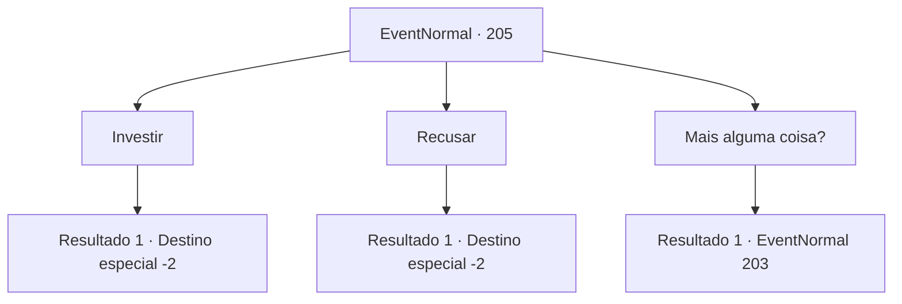

# Eventos normais · 205

[Índice da tabela](index.md) · [Índice geral](../index.md)

ID: `pt:EventNormal:205` · Fonte: `EventNormal4` · Versão: 1.2.47.

Mapeamento estático dos arquivos; a disponibilidade e a execução dependem do estado da run.

## Texto do evento

*Sem texto no arquivo.*

## Dados de entrada

```json
{
  "id": 205,
  "grade": 1,
  "place": "",
  "required": ""
}
```

## Mapa das escolhas



## Escolhas e resultados

### Escolha 1

Investir

Requisitos e outros campos da escolha:

```json
{
  "required": "1_4_100"
}
```

#### Resultado 1.1

Você decide investir no Produto de Investimento Novo Aventureiro. Ele lhe entrega um pergaminho e pede para colocar sua impressão digital nele. Há uma nota de advertência escrita no pergaminho dizendo que eles não são responsáveis ​​por qualquer perda feita com os investimentos. Quando você coloca sua impressão digital, ele sorri alegremente e diz que espera que seu investimento corra bem.

Continuação registrada: [Destino especial `-2`](../destinos-especiais.md).

```json
{
  "required": "",
  "chance": "1",
  "nextEvent": -2,
  "type": 2,
  "reward": "5_128_1|0_4_-100|0_2_1"
}
```

### Escolha 2

Recusar

Requisitos e outros campos da escolha:

```json
{
  "required": ""
}
```

#### Resultado 2.1

Você decide não investir e se afasta do palco.

Continuação registrada: [Destino especial `-2`](../destinos-especiais.md).

```json
{
  "required": "",
  "chance": "1",
  "nextEvent": -2,
  "type": 2,
  "reward": "5_128_9"
}
```

### Escolha 3

Mais alguma coisa?

Requisitos e outros campos da escolha:

```json
{
  "required": ""
}
```

#### Resultado 3.1

Você diz que quer ouvir uma explicação sobre outros produtos de investimento. Ele sorri, dizendo 'Claro'.

Continuação registrada: [Evento 203](0203.md) na mesma tabela.

```json
{
  "required": "",
  "chance": "1",
  "nextEvent": 203,
  "type": 2,
  "reward": ""
}
```

## Referências que chegam a este evento

- [Evento 204 · escolha 1 · resultado 1](0204.md#escolha-1)
