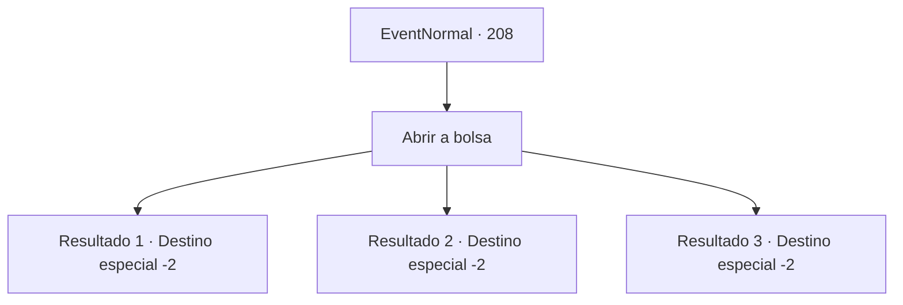

# Eventos normais · 208

[Índice da tabela](index.md) · [Índice geral](../index.md)

ID: `pt:EventNormal:208` · Fonte: `EventNormal4` · Versão: 1.2.47.

Mapeamento estático dos arquivos; a disponibilidade e a execução dependem do estado da run.

## Texto do evento

Uma coruja de cor marrom voa até você. Você viu esta coruja no estande apresentando o negócio de investimentos da última vez. A coruja joga uma bolsa de couro para você e voa novamente.

## Dados de entrada

```json
{
  "id": 208,
  "grade": 2,
  "place": "",
  "required": "5_128_1"
}
```

## Mapa das escolhas



## Escolhas e resultados

### Escolha 1

Abrir a bolsa

Requisitos e outros campos da escolha:

```json
{
  "required": ""
}
```

#### Resultado 1.1

A bolsa que você recebeu contém uma carta escrita em carta cursiva elegante e um pouco de ouro.
 'Nós informamos sobre o status do seu investimento. Seus aventureiros patrocinados derrotaram com sucesso um bando de goblins. Estamos enviando parte do ouro que eles encontraram.'


Continuação registrada: [Destino especial `-2`](../destinos-especiais.md).

```json
{
  "required": "",
  "chance": "2",
  "nextEvent": -2,
  "type": 2,
  "reward": "0_4_50|5_128_2|0_2_1"
}
```

#### Resultado 1.2

A bolsa que você recebeu contém uma carta escrita em carta cursiva elegante.
 'Nós informamos sobre o status do seu investimento. Todos os seus aventureiros patrocinados foram mortos no ataque de Grifo.'
 Parece que seu investimento foi destruído.

Continuação registrada: [Destino especial `-2`](../destinos-especiais.md).

```json
{
  "required": "",
  "chance": "3",
  "nextEvent": -2,
  "type": 2,
  "reward": "5_128_9"
}
```

#### Resultado 1.3

A bolsa que você recebeu contém uma carta escrita em carta cursiva elegante e um pouco de ouro.
 'Nós informamos sobre o status do seu investimento. Seus aventureiros patrocinados exploraram com sucesso as ruínas do deserto. Estamos enviando parte do ouro que eles encontraram.'


Continuação registrada: [Destino especial `-2`](../destinos-especiais.md).

```json
{
  "required": "",
  "chance": "1",
  "nextEvent": -2,
  "type": 2,
  "reward": "0_4_70|5_128_2|0_2_1"
}
```

## Referências que chegam a este evento

Nenhum `nextEvent` positivo da mesma tabela aponta para este nó. Isso não prova que seja inacessível: sorteio e estado de história podem selecioná-lo.

