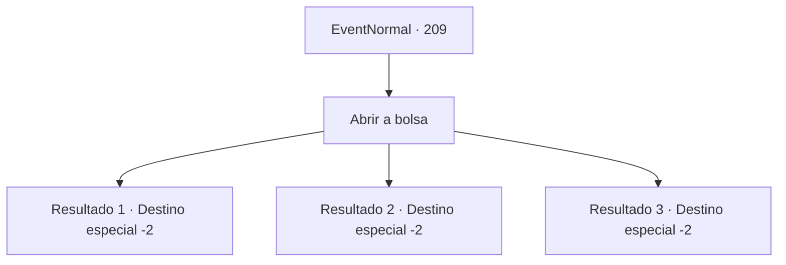

# Eventos normais · 209

[Índice da tabela](index.md) · [Índice geral](../index.md)

ID: `pt:EventNormal:209` · Fonte: `EventNormal4` · Versão: 1.2.47.

Mapeamento estático dos arquivos; a disponibilidade e a execução dependem do estado da run.

## Texto do evento

Desta vez, uma coruja marrom voa e joga para você uma bolsa de couro. Você se pergunta como aquela coruja encontra você todas as vezes, e toca na sua bolsa. 

## Dados de entrada

```json
{
  "id": 209,
  "grade": 2,
  "place": "",
  "required": "5_128_2"
}
```

## Mapa das escolhas



## Escolhas e resultados

### Escolha 1

Abrir a bolsa

Requisitos e outros campos da escolha:

```json
{
  "required": ""
}
```

#### Resultado 1.1

A bolsa que você recebeu contém uma carta escrita na mesma fonte da última vez e dourada.
 'Nós informamos sobre o status do seu investimento. Seus aventureiros patrocinados descobriram um tesouro escondido em uma caverna profunda. Estamos enviando parte do ouro que eles encontraram.'


Continuação registrada: [Destino especial `-2`](../destinos-especiais.md).

```json
{
  "required": "",
  "chance": "2",
  "nextEvent": -2,
  "type": 2,
  "reward": "0_4_80|5_128_3|0_2_1"
}
```

#### Resultado 1.2

A bolsa que você recebeu contém uma carta escrita na mesma fonte da última vez e dourada.
 'Nós informamos sobre o status do seu investimento. Seus aventureiros patrocinados fizeram uma expedição a uma caverna, resultando em duas baixas e duas perdidas.'
 Esse foi o fim da carta.

Continuação registrada: [Destino especial `-2`](../destinos-especiais.md).

```json
{
  "required": "",
  "chance": "3",
  "nextEvent": -2,
  "type": 2,
  "reward": "5_128_9"
}
```

#### Resultado 1.3

A bolsa que você recebeu contém uma carta escrita na mesma fonte da última vez e dourada.
 'Nós informamos sobre o status do seu investimento. Seus aventureiros patrocinados encontraram tesouros em uma antiga ruína. Estamos enviando parte do ouro que eles encontraram.'


Continuação registrada: [Destino especial `-2`](../destinos-especiais.md).

```json
{
  "required": "",
  "chance": "1",
  "nextEvent": -2,
  "type": 2,
  "reward": "0_4_120|5_128_3|0_2_1"
}
```

## Referências que chegam a este evento

Nenhum `nextEvent` positivo da mesma tabela aponta para este nó. Isso não prova que seja inacessível: sorteio e estado de história podem selecioná-lo.

