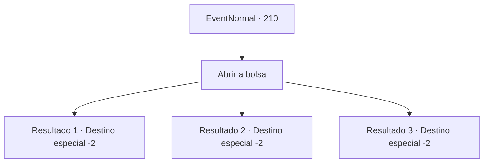

# Eventos normais · 210

[Índice da tabela](index.md) · [Índice geral](../index.md)

ID: `pt:EventNormal:210` · Fonte: `EventNormal4` · Versão: 1.2.47.

Mapeamento estático dos arquivos; a disponibilidade e a execução dependem do estado da run.

## Texto do evento

Uma coruja azulada voa até você. Você viu esta coruja no estande apresentando o negócio de investimentos da última vez. A coruja joga uma bolsa de couro para você e se senta em seu ombro. 

## Dados de entrada

```json
{
  "id": 210,
  "grade": 2,
  "place": "",
  "required": "5_129_1"
}
```

## Mapa das escolhas



## Escolhas e resultados

### Escolha 1

Abrir a bolsa

Requisitos e outros campos da escolha:

```json
{
  "required": ""
}
```

#### Resultado 1.1

Há relatórios cursivos de investimentos e jornais na bolsa. 
<O Desastre do Mal Negro que Queimou as Terras Agrícolas, Estamos Errando de Novo?>
 De acordo com o jornal, os caçadores da Guilda Caçadores de Monstros em que você investiu, após meses de emboscada, lutaram contra um feroz Dragão Negro chamado Desastre do Mal Negro, mas não conseguiram derrubá-lo. Lord Cohen, o chefe da Guilda Caçadores de Monstros, supostamente se recusou a ser entrevistado. O relatório de investimento diz que seria melhor esperar um pouco mais.

Continuação registrada: [Destino especial `-2`](../destinos-especiais.md).

```json
{
  "required": "",
  "chance": "1",
  "nextEvent": -2,
  "type": 2,
  "reward": ""
}
```

#### Resultado 1.2

Há relatórios cursivos de investimentos e jornais na bolsa. 
<O Desastre do Mal Negro Pode Nunca ser Derrotado!>
 De acordo com o jornal, os caçadores da Guilda Caçadores de Monstros em que você investiu, após meses de emboscada, lutaram contra um feroz Dragão Negro chamado Desastre do Mal Negro, porém foram aniquilados. O relatório de investimento diz que a guilda será dissolvida.

Continuação registrada: [Destino especial `-2`](../destinos-especiais.md).

```json
{
  "required": "",
  "chance": "1",
  "nextEvent": -2,
  "type": 2,
  "reward": "5_129_9"
}
```

#### Resultado 1.3

A bolsa contém relatórios cursivos de investimentos, jornais e grandes quantidades de ouro. 
<O Desastre do Mal Negro que Queimou a Fazenda, Derrotado!>
 De acordo com o jornal, os caçadores da Guilda Caçadores de Monstros em que você investiu, após meses de emboscada, lutaram contra um feroz Dragão Negro chamado Desastre do Mal Negro e conseguiram derrotá-lo. Lord Cohen, o chefe da Guilda Caçadores de Monstros, elogiou os caçadores, descrevendo esta grande vitória como um 'resultado preparado'. O relatório de investimento também prevê que o futuro da guilda será lucrativo.

Continuação registrada: [Destino especial `-2`](../destinos-especiais.md).

```json
{
  "required": "",
  "chance": "1",
  "nextEvent": -2,
  "type": 2,
  "reward": "0_4_200|5_129_2|0_2_1"
}
```

## Referências que chegam a este evento

Nenhum `nextEvent` positivo da mesma tabela aponta para este nó. Isso não prova que seja inacessível: sorteio e estado de história podem selecioná-lo.

