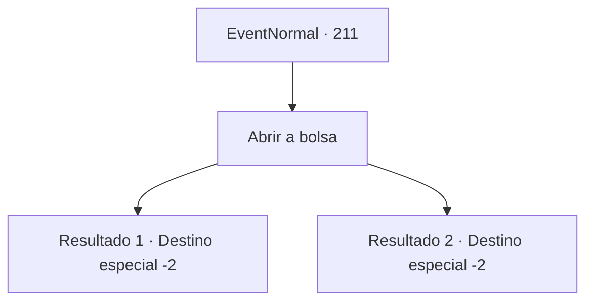

# Eventos normais · 211

[Índice da tabela](index.md) · [Índice geral](../index.md)

ID: `pt:EventNormal:211` · Fonte: `EventNormal4` · Versão: 1.2.47.

Mapeamento estático dos arquivos; a disponibilidade e a execução dependem do estado da run.

## Texto do evento

Desta vez, uma coruja azulada voa e joga uma bolsa de couro para você. Você se pergunta como aquela coruja encontra você todas as vezes, e toca na sua bolsa. 

## Dados de entrada

```json
{
  "id": 211,
  "grade": 2,
  "place": "",
  "required": "5_129_2"
}
```

## Mapa das escolhas



## Escolhas e resultados

### Escolha 1

Abrir a bolsa

Requisitos e outros campos da escolha:

```json
{
  "required": ""
}
```

#### Resultado 1.1

A bolsa contém relatórios cursivos de investimentos, jornais e grandes quantidades de ouro. 
<Governante dos Vampiros, um Fim para seus Esforços Malignos!>
 De acordo com o jornal, os caçadores despachados da Guilda Caçadores de Monstros investigaram desaparecimentos suspeitos de mulheres. E eles descobriram que o Lorde Vampiro estava envolvido no incidente. Lorde Vampiro resistiu persistentemente, mas não conseguiu igualar os caçadores habilidosos e, eventualmente, desapareceu no ar. O relatório de investimento diz que eles vão distribuir a riqueza do castelo do vampiro.

Continuação registrada: [Destino especial `-2`](../destinos-especiais.md).

```json
{
  "required": "",
  "chance": "1",
  "nextEvent": -2,
  "type": 2,
  "reward": "0_4_200|5_129_9|0_2_1"
}
```

#### Resultado 1.2

A bolsa contém relatórios cursivos de investimentos, jornais. 
<O Desaparecimento dos Caçadores Investigando Desaparecimentos Suspeitos de Mulheres!>
 De acordo com o jornal, os caçadores despachados da Guilda Caçadores de Monstros perseguiam desaparecimentos suspeitos de mulheres. Mas nenhum dos caçadores enviados retornou, e a guilda decidiu não investigar mais o desaparecimento.

Continuação registrada: [Destino especial `-2`](../destinos-especiais.md).

```json
{
  "required": "",
  "chance": "2",
  "nextEvent": -2,
  "type": 2,
  "reward": "5_129_9"
}
```

## Referências que chegam a este evento

Nenhum `nextEvent` positivo da mesma tabela aponta para este nó. Isso não prova que seja inacessível: sorteio e estado de história podem selecioná-lo.

