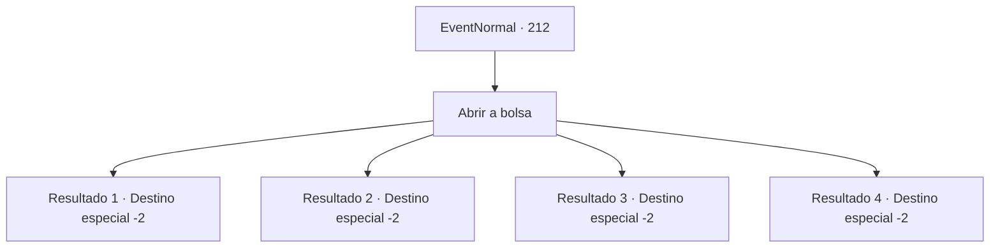

# Eventos normais · 212

[Índice da tabela](index.md) · [Índice geral](../index.md)

ID: `pt:EventNormal:212` · Fonte: `EventNormal4` · Versão: 1.2.47.

Mapeamento estático dos arquivos; a disponibilidade e a execução dependem do estado da run.

## Texto do evento

Uma coruja branca voa até você. Você viu esta coruja no estande apresentando o negócio de investimentos da última vez. A coruja joga uma bolsa de couro e voa novamente.

## Dados de entrada

```json
{
  "id": 212,
  "grade": 2,
  "place": "",
  "required": "5_130_1"
}
```

## Mapa das escolhas



## Escolhas e resultados

### Escolha 1

Abrir a bolsa

Requisitos e outros campos da escolha:

```json
{
  "required": ""
}
```

#### Resultado 1.1

A bolsa contém uma carta rabiscada com uma caligrafia difícil de reconhecer e uma quantidade considerável de ouro. 

 "Construímos uma base de suprimentos nas Ilhas do Vento Gelado. É um lugar onde os barcos de pesca não costumam vir, então lucramos muito com a montanha de peixes. Enviamos a sua parte. Nós entraremos em contato com você mais cedo ou mais tarde."

 Havia também uma carta em cursiva elegante. A carta afirma que eles estão ansiosos por suas atividades.

Continuação registrada: [Destino especial `-2`](../destinos-especiais.md).

```json
{
  "required": "",
  "chance": "1",
  "nextEvent": -2,
  "type": 2,
  "reward": "0_4_100|5_130_2|0_2_1"
}
```

#### Resultado 1.2

A bolsa contém uma carta rabiscada com uma caligrafia difícil de reconhecer e uma quantidade considerável de ouro. 

 "Chegamos às Ilhas do Vento Gelado. O tempo estava tão ruim que não pudemos trabalhar direito, mas pegamos algumas colheitas em alto-mar. Vamos ganhar mais dinheiro da próxima vez."

 Há também o relatório de investimento informando que o lucro pode ser melhorado dependendo de esforços futuros.

Continuação registrada: [Destino especial `-2`](../destinos-especiais.md).

```json
{
  "required": "",
  "chance": "1",
  "nextEvent": -2,
  "type": 2,
  "reward": "0_4_60|5_130_2|0_2_1"
}
```

#### Resultado 1.3

A bolsa contém uma carta rabiscada em uma caligrafia difícil de reconhecer e uma carta escrita em uma elegante carta cursiva. Uma carta rabiscada parece ter sido escrita pelo capitão do navio de captura de Kraken em que você investiu. 

 "Chegamos às Ilhas do Vento Gelado, mas a maldita tempestade não parou por um único dia. Não nos culpe. Nossos corações estão queimando."

 E a carta cursiva é um relatório de investimento. Ele diz que, embora não haja lucro, você deve esperar por mais atividade.

Continuação registrada: [Destino especial `-2`](../destinos-especiais.md).

```json
{
  "required": "",
  "chance": "1",
  "nextEvent": -2,
  "type": 2,
  "reward": "5_130_2"
}
```

#### Resultado 1.4

A bolsa que você recebeu contém uma carta escrita em letra cursiva elegante.
 'Nós informamos sobre o status do seu investimento. Seu navio patrocinador Caça Kraken desapareceu no Mar de Gelo. Pode ser difícil esperar notícias deles.'
 Esse foi o fim da carta.

Continuação registrada: [Destino especial `-2`](../destinos-especiais.md).

```json
{
  "required": "",
  "chance": "1",
  "nextEvent": -2,
  "type": 2,
  "reward": "5_130_9"
}
```

## Referências que chegam a este evento

Nenhum `nextEvent` positivo da mesma tabela aponta para este nó. Isso não prova que seja inacessível: sorteio e estado de história podem selecioná-lo.

