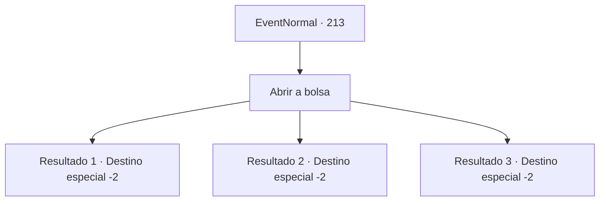

# Eventos normais · 213

[Índice da tabela](index.md) · [Índice geral](../index.md)

ID: `pt:EventNormal:213` · Fonte: `EventNormal4` · Versão: 1.2.47.

Mapeamento estático dos arquivos; a disponibilidade e a execução dependem do estado da run.

## Texto do evento

Assim como da última vez, uma coruja branca voa e joga para você uma bolsa de couro. Você se pergunta como aquela coruja encontra você todas as vezes, e toca na sua bolsa. 

## Dados de entrada

```json
{
  "id": 213,
  "grade": 2,
  "place": "",
  "required": "5_130_2"
}
```

## Mapa das escolhas



## Escolhas e resultados

### Escolha 1

Abrir a bolsa

Requisitos e outros campos da escolha:

```json
{
  "required": ""
}
```

#### Resultado 1.1

A bolsa contém uma carta rabiscada com uma caligrafia difícil de reconhecer, uma quantidade considerável de ouro e um longo arpão. 

 "Finalmente, pegamos o Kraken! O desgraçado lutou até o fim, mas fomos mais persistentes. Os tentáculos nojentos eram quase do tamanho de uma cabeça humana. Você consegue imaginar? O corpo do Kraken foi vendido a um bom preço para os nobres do continente. Então, nós lhe enviamos sua parte do lucro. Agora que a rota comercial do Mar de Gelo está aberta, mais lucro ainda está por vir."

 Esse foi o fim da carta.

Continuação registrada: [Destino especial `-2`](../destinos-especiais.md).

```json
{
  "required": "",
  "chance": "1",
  "nextEvent": -2,
  "type": 2,
  "reward": "0_4_200|5_130_3|3_164_1|0_2_1"
}
```

#### Resultado 1.2

A bolsa contém uma carta rabiscada com uma caligrafia difícil de reconhecer e uma quantidade considerável de ouro. 

 "Finalmente encontramos o Kraken, mas não conseguimos matá-lo. Eu não esperava que ele conseguisse fugir depois de levar tantos ataques. Felizmente, encontramos o navio naufragado que o Kraken havia ocupado como um ninho. Não podemos ficar com todos eles, mas temos algo útil, por isso estamos enviando alguns para você. Nós expulsamos aquele octópode e agora os navios poderão navegar por um tempo."

 Apesar de tudo, parece que eles fracassaram em derrubar o diabo do mar.

Continuação registrada: [Destino especial `-2`](../destinos-especiais.md).

```json
{
  "required": "",
  "chance": "1",
  "nextEvent": -2,
  "type": 2,
  "reward": "0_4_100|5_130_3|0_2_1"
}
```

#### Resultado 1.3

Na bolsa que você recebeu, há uma nota escrita com uma caligrafia mais difícil ainda de ler do que antes. 

 "Sinto muito, mas acho que esta será minha última mensagem. O navio está destruído. O diabo marinho vive. Metade da tripulação morreu e minha perna direita foi cortada. Não consigo continuar. Parece que também não posso pagar seus investimentos. Fique bem."

 Parece que o investimento foi uma má ideia. Você não tem muito o que fazer nessa situação.

Continuação registrada: [Destino especial `-2`](../destinos-especiais.md).

```json
{
  "required": "",
  "chance": "1",
  "nextEvent": -2,
  "type": 2,
  "reward": "5_130_9"
}
```

## Referências que chegam a este evento

Nenhum `nextEvent` positivo da mesma tabela aponta para este nó. Isso não prova que seja inacessível: sorteio e estado de história podem selecioná-lo.

