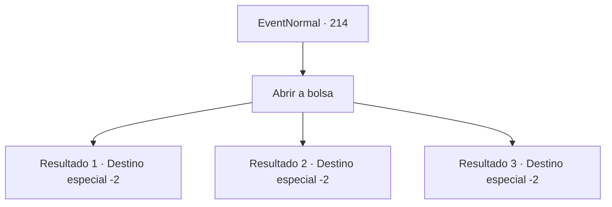

# Eventos normais · 214

[Índice da tabela](index.md) · [Índice geral](../index.md)

ID: `pt:EventNormal:214` · Fonte: `EventNormal4` · Versão: 1.2.47.

Mapeamento estático dos arquivos; a disponibilidade e a execução dependem do estado da run.

## Texto do evento

Uma coruja agora familiar voa diante de seus olhos. Dá-lhe a bolsa de couro, senta-se no seu ombro e esfrega a cabeça em você. 

## Dados de entrada

```json
{
  "id": 214,
  "grade": 2,
  "place": "",
  "required": "5_130_3"
}
```

## Mapa das escolhas



## Escolhas e resultados

### Escolha 1

Abrir a bolsa

Requisitos e outros campos da escolha:

```json
{
  "required": ""
}
```

#### Resultado 1.1

Há muito ouro na bolsa que você recebe. 

 "Estabelecemos uma rota entre o porto continental e o Mar de Gelo. Agora que o Kraken se foi, os barqueiros estão usando o caminho que criamos. Graças a você, o mapa do mar foi vendido a um preço alto, por isso estamos o enviando. Obrigado pela ajuda."

 Quando você termina de ler a carta, a coruja voa para o céu.

Continuação registrada: [Destino especial `-2`](../destinos-especiais.md).

```json
{
  "required": "",
  "chance": "1",
  "nextEvent": -2,
  "type": 2,
  "reward": "0_4_200|5_130_4|0_2_1"
}
```

#### Resultado 1.2

Há muito ouro na bolsa que você recebe. 

 "Navios estão rodando na rota que fomos pioneiros. Mas os piratas também apareceram, então não é tanto dinheiro quanto eu pensava. Mas não é um déficit. De qualquer forma, obrigado pela ajuda."

 Quando você termina de ler a carta, a coruja voa para o céu.

Continuação registrada: [Destino especial `-2`](../destinos-especiais.md).

```json
{
  "required": "",
  "chance": "1",
  "nextEvent": -2,
  "type": 2,
  "reward": "0_4_150|5_130_4|0_2_1"
}
```

#### Resultado 1.3

Não havia nada além de uma carta amassada na bolsa. 

 "Quase tudo foi para o sul. Os icebergs deslizaram pela rota mal conectada e os navios mercantes desmoronaram. Que incompetente, eu não consigo acreditar que eles não foram capazes de evitá-lo como marinheiros. Bem, acho que devemos nos contentar em pegar o Kraken. Obrigado pela ajuda."

 Quando você termina de ler a carta, a coruja voa para o céu.

Continuação registrada: [Destino especial `-2`](../destinos-especiais.md).

```json
{
  "required": "",
  "chance": "1",
  "nextEvent": -2,
  "type": 2,
  "reward": "5_130_4"
}
```

## Referências que chegam a este evento

Nenhum `nextEvent` positivo da mesma tabela aponta para este nó. Isso não prova que seja inacessível: sorteio e estado de história podem selecioná-lo.

