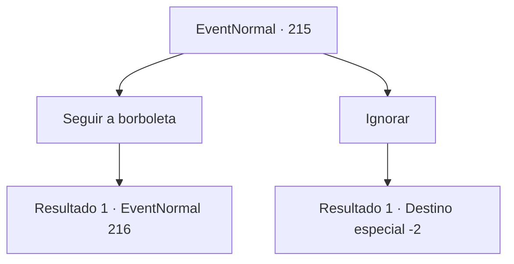

# Eventos normais · 215

[Índice da tabela](index.md) · [Índice geral](../index.md)

ID: `pt:EventNormal:215` · Fonte: `EventNormal4` · Versão: 1.2.47.

Mapeamento estático dos arquivos; a disponibilidade e a execução dependem do estado da run.

## Texto do evento

Você encontra a borboleta espalhando luz azul novamente. Está pairando ao seu redor com mais violência do que da última vez, como se estivesse sinalizando para você a seguir. 

## Dados de entrada

```json
{
  "id": 215,
  "grade": 2,
  "place": "",
  "required": "5_131_1"
}
```

## Mapa das escolhas



## Escolhas e resultados

### Escolha 1

Seguir a borboleta

Requisitos e outros campos da escolha:

```json
{
  "required": ""
}
```

#### Resultado 1.1

Você decide confiar na borboleta mais uma vez. Seguindo a borboleta dançando violentamente, surge um lago claro. |drawing_pondWithNimph| E ali, uma ninfa de orelhas pontudas está sentada à beira da água cambaleando. Ela sorri para você. 

 "Hehe! Me desculpe~ Eu zombei de você da última vez. Que tal apresentar um amigo em vez disso?"


Continuação registrada: [Evento 216](0216.md) na mesma tabela.

```json
{
  "required": "",
  "chance": "1",
  "nextEvent": 216,
  "type": 2,
  "reward": ""
}
```

### Escolha 2

Ignorar

Requisitos e outros campos da escolha:

```json
{
  "required": ""
}
```

#### Resultado 2.1

Você lembra das memórias do passado e decide não seguir a borboleta. A borboleta paira em torno de você por um tempo e desaparece.

Continuação registrada: [Destino especial `-2`](../destinos-especiais.md).

```json
{
  "required": "",
  "chance": "1",
  "nextEvent": -2,
  "type": 2,
  "reward": ""
}
```

## Referências que chegam a este evento

Nenhum `nextEvent` positivo da mesma tabela aponta para este nó. Isso não prova que seja inacessível: sorteio e estado de história podem selecioná-lo.

