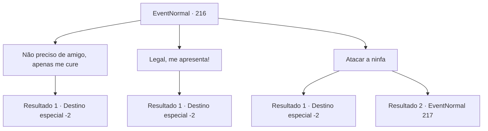

# Eventos normais · 216

[Índice da tabela](index.md) · [Índice geral](../index.md)

ID: `pt:EventNormal:216` · Fonte: `EventNormal4` · Versão: 1.2.47.

Mapeamento estático dos arquivos; a disponibilidade e a execução dependem do estado da run.

## Texto do evento

*Sem texto no arquivo.*

## Dados de entrada

```json
{
  "id": 216,
  "grade": 1,
  "place": "",
  "required": ""
}
```

## Mapa das escolhas



## Escolhas e resultados

### Escolha 1

Não preciso de amigo, apenas me cure

Requisitos e outros campos da escolha:

```json
{
  "required": ""
}
```

#### Resultado 1.1

Você acena com a mão e diz que não precisa de um novo amigo. Em vez disso, você pede para pagar o tratamento porque você caiu e se machucou. 

 "Certo, muito bem..."

 A ninfa dá de ombros e lhe dá uma poção. Quando você pega a poção, ela desaparece na floresta.

Continuação registrada: [Destino especial `-2`](../destinos-especiais.md).

```json
{
  "required": "",
  "chance": "1",
  "nextEvent": -2,
  "type": 2,
  "reward": "5_131_2|3_36_1|0_2_1"
}
```

### Escolha 2

Legal, me apresenta!

Requisitos e outros campos da escolha:

```json
{
  "required": ""
}
```

#### Resultado 2.1

A ninfa agita o dedo e, ao mesmo tempo, um brilho sutil brota da lagoa. E os torrões de água aos poucos vão tomando forma e saindo da lagoa. 

 "Este é o Mori. É um elemental da água. É pequeno, mas vai te ajudar."

 O elemental fica mole em sua mochila. Você fica preocupado que a mochila possa ficar molhada, mas não acontece. A ninfa, depois de assistir, balança as mãos e desaparece na mata. 

 "Então tchau!"


Continuação registrada: [Destino especial `-2`](../destinos-especiais.md).

```json
{
  "required": "",
  "chance": "1",
  "nextEvent": -2,
  "type": 2,
  "reward": "5_131_3|3_192_1|0_2_1"
}
```

### Escolha 3

Atacar a ninfa

Requisitos e outros campos da escolha:

```json
{
  "required": "2_3_0"
}
```

#### Resultado 3.1

Você sente vontade de matar a ninfa risonha. Quando você coloca a mão na arma, ela faz uma cara de surpresa e rapidamente desaparece na floresta.

Continuação registrada: [Destino especial `-2`](../destinos-especiais.md).

```json
{
  "required": "1_2_50",
  "chance": "1",
  "nextEvent": -2,
  "type": 2,
  "reward": "5_131_4"
}
```

#### Resultado 3.2

Você sente vontade de matar a ninfa risonha. Quando você coloca a mão na arma, ela se levanta e franze a testa. 

 "Huh... se você quer lutar assim"


Continuação registrada: [Evento 217](0217.md) na mesma tabela.

```json
{
  "required": "2_2_50",
  "chance": "1",
  "nextEvent": 217,
  "type": 2,
  "reward": "6_0_32|5_131_4",
  "place": 1
}
```

## Referências que chegam a este evento

- [Evento 215 · escolha 1 · resultado 1](0215.md#escolha-1)
