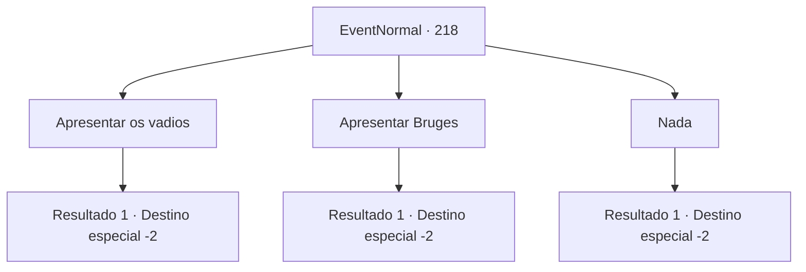

# Eventos normais · 218

[Índice da tabela](index.md) · [Índice geral](../index.md)

ID: `pt:EventNormal:218` · Fonte: `EventNormal4` · Versão: 1.2.47.

Mapeamento estático dos arquivos; a disponibilidade e a execução dependem do estado da run.

## Texto do evento

*Sem texto no arquivo.*

## Dados de entrada

```json
{
  "id": 218,
  "grade": 1,
  "place": "",
  "required": ""
}
```

## Mapa das escolhas



## Escolhas e resultados

### Escolha 1

Apresentar os vadios

Requisitos e outros campos da escolha:

```json
{
  "required": "-1|12_2_5|12_2_6|14_2_4|14_2_3|5_200_1"
}
```

#### Resultado 1.1

Você se lembra dos vagabundos que exploraram com você como novos clientes de Kiki. Então você escreve uma carta de apresentação para Kiki e a entrega. Ela sorri brilhantemente e abaixa a cabeça para agradecer de novo e de novo. 

 "Não é muito dinheiro, mas por favor, aceite!"

 Ela entregou uma pequena bolsa de ouro. Então, ela vai embora acenando com a mão.

Continuação registrada: [Destino especial `-2`](../destinos-especiais.md).

```json
{
  "required": "",
  "chance": "1",
  "nextEvent": -2,
  "type": 2,
  "reward": "0_4_50|5_127_4|0_2_1"
}
```

### Escolha 2

Apresentar Bruges

Requisitos e outros campos da escolha:

```json
{
  "required": "-1|12_4_4|12_4_6|5_199_1"
}
```

#### Resultado 2.1

Você pensa em Bruges e nos refugiados do norte como os novos clientes da Kiki. Então você escreve uma carta de apresentação para Kiki e a entrega. Ela sorri brilhantemente e abaixa a cabeça para agradecer de novo e de novo. 

 "Não é muito dinheiro, mas por favor, aceite!"

 Ela entregou uma pequena bolsa de ouro. Então, ela vai embora acenando com a mão.

Continuação registrada: [Destino especial `-2`](../destinos-especiais.md).

```json
{
  "required": "",
  "chance": "1",
  "nextEvent": -2,
  "type": 2,
  "reward": "0_4_50|5_127_5|0_2_1"
}
```

### Escolha 3

Nada

Requisitos e outros campos da escolha:

```json
{
  "required": ""
}
```

#### Resultado 3.1

Mas você não consegue pensar em ninguém apropriado para recomendar. Você promete que irá avisá-la sobre qualquer pessoa recomendável e vai embora.

Continuação registrada: [Destino especial `-2`](../destinos-especiais.md).

```json
{
  "required": "",
  "chance": "1",
  "nextEvent": -2,
  "type": 2,
  "reward": "5_127_2"
}
```

## Referências que chegam a este evento

- [Evento 191 · escolha 4 · resultado 1](0191.md#escolha-4)
