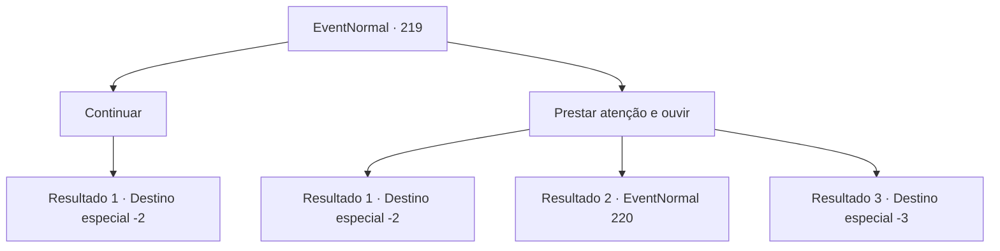

# Eventos normais · 219

[Índice da tabela](index.md) · [Índice geral](../index.md)

ID: `pt:EventNormal:219` · Fonte: `EventNormal4` · Versão: 1.2.47.

Mapeamento estático dos arquivos; a disponibilidade e a execução dependem do estado da run.

## Texto do evento

Você chega em uma costa tranquila. Uma brisa refrescante do mar toca você.  Em algum lugar, uma bela voz cantando uma música pode ser ouvida.

## Dados de entrada

```json
{
  "id": 219,
  "grade": 1,
  "place": "",
  "required": ""
}
```

## Mapa das escolhas



## Escolhas e resultados

### Escolha 1

Continuar

Requisitos e outros campos da escolha:

```json
{
  "required": ""
}
```

#### Resultado 1.1

Você olha para o mar por um momento e segue em frente.

Continuação registrada: [Destino especial `-2`](../destinos-especiais.md).

```json
{
  "required": "",
  "chance": "1",
  "nextEvent": -2,
  "type": 2,
  "reward": ""
}
```

### Escolha 2

Prestar atenção e ouvir

Requisitos e outros campos da escolha:

```json
{
  "required": ""
}
```

#### Resultado 2.1

Uma linda mulher está cantando uma música, sentada em uma pedra na água. Deslumbrado com a melodia encantadora sem precedentes, você fica surpreso ao se encontrar caminhando cegamente em direção à água. Você mesmo junta as pernas, para não cair no mar. A música parece que cura sua mente e toca sua alma. Depois de terminar sua música, a mulher desliza na água, com um olhar desapontado no rosto. A parte inferior do corpo dela não era humana e se parecia com a de um peixe.

Continuação registrada: [Destino especial `-2`](../destinos-especiais.md).

```json
{
  "required": "1_14_14",
  "chance": "1",
  "nextEvent": -2,
  "type": 2,
  "reward": "0_1_1|0_2_1"
}
```

#### Resultado 2.2

Antes que você perceba, você está andando passo a passo no mar, atraído pela melodia. Quando a água está quase cobrindo seu pescoço, você se torna consciente novamente do espanto do frio. Mas parece tarde. Uma sereia está nadando em sua direção, cortando as ondas.

Continuação registrada: [Evento 220](0220.md) na mesma tabela.

```json
{
  "required": "2_14_14|1_1_2",
  "chance": "1",
  "nextEvent": 220,
  "type": 2,
  "reward": "0_1_-1|6_3_99",
  "place": 3
}
```

#### Resultado 2.3

Antes que você perceba, você está andando passo a passo no mar, atraído pela melodia. Um passo e outro passo... Você só pensa em ouvir melhor aquela música de mais perto. Você afunda no mar, ouvindo o canto feliz da sereia. Você perde a consciência. 

Continuação registrada: [Destino especial `-3`](../destinos-especiais.md).

```json
{
  "required": "2_14_14|2_1_2",
  "chance": "1",
  "nextEvent": -3,
  "type": 2,
  "reward": "0_1_-1"
}
```

## Referências que chegam a este evento

Nenhum `nextEvent` positivo da mesma tabela aponta para este nó. Isso não prova que seja inacessível: sorteio e estado de história podem selecioná-lo.

