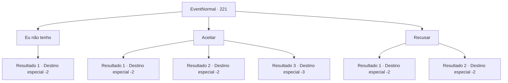

# Eventos normais · 221

[Índice da tabela](index.md) · [Índice geral](../index.md)

ID: `pt:EventNormal:221` · Fonte: `EventNormal4` · Versão: 1.2.47.

Mapeamento estático dos arquivos; a disponibilidade e a execução dependem do estado da run.

## Texto do evento


 "Eu faço sashimi de graça! Sashimi bem aqui! Sashimi fresco! Melhor se o ingrediente for sua própria pescaria!"

 Um cozinheiro de aparência jovem se aproxima de você com um sorriso, percorrendo com entusiasmo as ruas da cidade. 

 "Como vai? Trabalho na estalagem 'Silver Sturgeon' como aprendiz de cozinheiro. Atualmente, estou estudando sobre refeições com cavalas, mas pessoalmente não é fácil comprá-las o tempo todo. Vou cozinhar de graça, então se você tiver uma cavala de reserva, você se importaria de me entregar uma?"


## Dados de entrada

```json
{
  "id": 221,
  "grade": 1,
  "place": "",
  "required": "5_171_0"
}
```

## Mapa das escolhas



## Escolhas e resultados

### Escolha 1

Eu não tenho

Requisitos e outros campos da escolha:

```json
{
  "required": "10_124_1"
}
```

#### Resultado 1.1

Você diz que não tem uma cavalinha. O aprendiz de cozinheiro vai embora desapontado.

Continuação registrada: [Destino especial `-2`](../destinos-especiais.md).

```json
{
  "required": "",
  "chance": "1",
  "nextEvent": -2,
  "type": 2,
  "reward": ""
}
```

### Escolha 2

Aceitar

Requisitos e outros campos da escolha:

```json
{
  "required": "8_124_1"
}
```

#### Resultado 2.1


 "Obrigado. Sente-se aqui e, por favor, espere um momento."

 Ele leva você para a cozinha da pousada. Depois de esperar um pouco, um sashimi de cavalinha de aparência elegante aparece diante de você. Quando você dá uma mordida, você sente como se a cavalinha estivesse dançando para cima e para baixo ativamente em sua boca. Você termina a deliciosa refeição e sai da pousada.

Continuação registrada: [Destino especial `-2`](../destinos-especiais.md).

```json
{
  "required": "",
  "chance": "1",
  "nextEvent": -2,
  "type": 2,
  "reward": "0_1_1|0_0_1|4_124_1|5_171_1"
}
```

#### Resultado 2.2


 "Obrigado. Sente-se aqui e, por favor, espere um momento."

 Ele leva você para a cozinha da pousada. Depois de muito tempo lutando com a cavalinha, um peixe cru mal manuseado aparece diante de você como um 'sashimi'. Quando você dá uma mordida, um cheiro nojento de peixe enche sua boca. Você vomita. Você nem sabe como aquele cozinheiro fez isso. O cozinheiro agarra seu corpo cambaleante e pega algumas moedas de ouro em seu bolso. 

 "Sinto muito. Isto é para o ingrediente..."

 Você sai da pousada às pressas, cuspindo aqui e ali. 

Continuação registrada: [Destino especial `-2`](../destinos-especiais.md).

```json
{
  "required": "1_1_2",
  "chance": "1",
  "nextEvent": -2,
  "type": 2,
  "reward": "0_1_-1|4_124_1|0_4_10|5_171_2"
}
```

#### Resultado 2.3


 "Obrigado. Sente-se aqui e, por favor, espere um momento."

 Ele leva você para a cozinha da pousada. Depois de muito tempo lutando com a cavalinha, um peixe cru mal manuseado aparece diante de você como um 'sashimi'. Quando você dá uma mordida, um cheiro nojento de peixe enche sua boca. Você cai no chão, exausto de vomitar. 

 "Olá? O que está acontecendo? Ei!"

 O que você realmente quer dizer é para o cozinheiro desistir do caminho culinário, mas as palavras não saem de sua boca. 

Continuação registrada: [Destino especial `-3`](../destinos-especiais.md).

```json
{
  "required": "2_1_2",
  "chance": "1",
  "nextEvent": -3,
  "type": 2,
  "reward": "0_1_-1|4_124_1|0_2_1"
}
```

### Escolha 3

Recusar

Requisitos e outros campos da escolha:

```json
{
  "required": ""
}
```

#### Resultado 3.1

Você diz que não tem uma cavalinha. Mas é quando uma cauda de cavalinha sai da sua mochila. Você rapidamente tenta fechar sua bolsa, porém o cozinheiro já viu. 

 "Vamos, agora..."

 O cozinheiro vai embora, resmungando.

Continuação registrada: [Destino especial `-2`](../destinos-especiais.md).

```json
{
  "required": "8_124_1",
  "chance": "1",
  "nextEvent": -2,
  "type": 2,
  "reward": "0_3_-1"
}
```

#### Resultado 3.2

Você diz que não tem uma cavalinha. O aprendiz de cozinheiro volta para a cozinha, desapontado.

Continuação registrada: [Destino especial `-2`](../destinos-especiais.md).

```json
{
  "required": "10_124_1",
  "chance": "1",
  "nextEvent": -2,
  "type": 2,
  "reward": ""
}
```

## Referências que chegam a este evento

Nenhum `nextEvent` positivo da mesma tabela aponta para este nó. Isso não prova que seja inacessível: sorteio e estado de história podem selecioná-lo.

