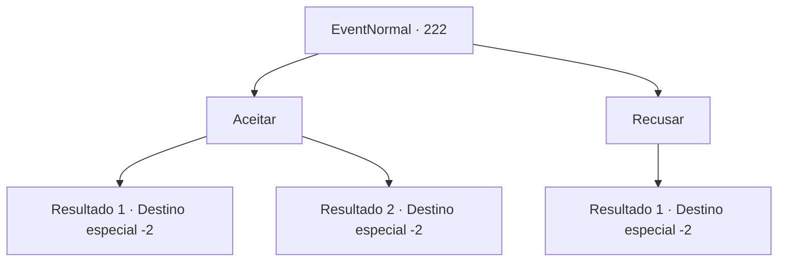

# Eventos normais · 222

[Índice da tabela](index.md) · [Índice geral](../index.md)

ID: `pt:EventNormal:222` · Fonte: `EventNormal4` · Versão: 1.2.47.

Mapeamento estático dos arquivos; a disponibilidade e a execução dependem do estado da run.

## Texto do evento


 "Por ali! Olá! Venha aqui por um segundo!!"

 Você vê um fazendeiro acenando com a mão no meio de um campo de trigo. Existem pilhas altas de composto, espalhadas pelo campo. 

 "Como você pode ver, o campo não é tão pequeno. Eu tenho que fertilizar a fazenda inteira hoje, você poderia me ajudar? Não posso pagar em ouro, mas vou dar-lhe algo para comer."


## Dados de entrada

```json
{
  "id": 222,
  "grade": 1,
  "place": "",
  "required": ""
}
```

## Mapa das escolhas



## Escolhas e resultados

### Escolha 1

Aceitar

Requisitos e outros campos da escolha:

```json
{
  "required": ""
}
```

#### Resultado 1.1

Você decide que vai aquecer seus músculos um pouco. O agricultor parece admirado com a boca aberta, enquanto você carrega os pesados ​​pacotes de composto com facilidade. 

 "Incrível! Este é um presente meu. Faça bom proveito."

 Depois que o trabalho termina, você recebe dele uma pilha de batatas.

Continuação registrada: [Destino especial `-2`](../destinos-especiais.md).

```json
{
  "required": "",
  "chance": "1|0_5_1",
  "nextEvent": -2,
  "type": 0,
  "reward": "3_137_2|0_2_1"
}
```

#### Resultado 1.2

Você carrega a pilha de composto com confiança, mas não tem o poder de impedir que ela caia. O agricultor estala a língua enquanto você se deita no chão, com composto por todo o corpo. 

 "Você nem consegue levantar algo assim e diz que é um aventureiro... Esqueça. Vou fazer isso sozinho."


Continuação registrada: [Destino especial `-2`](../destinos-especiais.md).

```json
{
  "required": "",
  "chance": "8",
  "nextEvent": -2,
  "type": 1,
  "reward": ""
}
```

### Escolha 2

Recusar

Requisitos e outros campos da escolha:

```json
{
  "required": ""
}
```

#### Resultado 2.1

Você segura o nariz no fedor do composto e rapidamente se afasta daquele lugar. O fazendeiro reclama, mas você age como se não pudesse ouvi-lo.

Continuação registrada: [Destino especial `-2`](../destinos-especiais.md).

```json
{
  "required": "",
  "chance": "1",
  "nextEvent": -2,
  "type": 2,
  "reward": ""
}
```

## Referências que chegam a este evento

Nenhum `nextEvent` positivo da mesma tabela aponta para este nó. Isso não prova que seja inacessível: sorteio e estado de história podem selecioná-lo.

