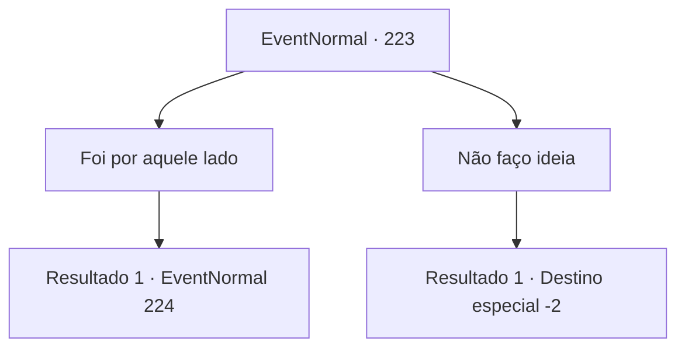

# Eventos normais · 223

[Índice da tabela](index.md) · [Índice geral](../index.md)

ID: `pt:EventNormal:223` · Fonte: `EventNormal4` · Versão: 1.2.47.

Mapeamento estático dos arquivos; a disponibilidade e a execução dependem do estado da run.

## Texto do evento

Você se depara com um pequeno cachorro quando está entrando em uma aldeia. Ele passa por você, desaparecendo nas ruas. Logo, um menino que aparentemente é o dono do cachorro corre atrás dele, ofegante. 

 "*Arf*, *Arf*... Você viu meu cachorrinho?"


## Dados de entrada

```json
{
  "id": 223,
  "grade": 1,
  "place": "",
  "required": ""
}
```

## Mapa das escolhas



## Escolhas e resultados

### Escolha 1

Foi por aquele lado

Requisitos e outros campos da escolha:

```json
{
  "required": ""
}
```

#### Resultado 1.1

Você diz a ele que o cachorro entrou no beco da rua do outro lado. Então ele fala, ainda respirando pesadamente. 

 "Huff... sério? A rua ali é como um labirinto. Ajude-me a procurar, por favor?"


Continuação registrada: [Evento 224](0224.md) na mesma tabela.

```json
{
  "required": "",
  "chance": "1",
  "nextEvent": 224,
  "type": 2,
  "reward": ""
}
```

### Escolha 2

Não faço ideia

Requisitos e outros campos da escolha:

```json
{
  "required": ""
}
```

#### Resultado 2.1

Mesmo antes que você possa terminar sua resposta, o menino corre para outro lugar como uma flecha. E provavelmente não é para onde o cachorro fugiu.

Continuação registrada: [Destino especial `-2`](../destinos-especiais.md).

```json
{
  "required": "",
  "chance": "1",
  "nextEvent": -2,
  "type": 2,
  "reward": ""
}
```

## Referências que chegam a este evento

Nenhum `nextEvent` positivo da mesma tabela aponta para este nó. Isso não prova que seja inacessível: sorteio e estado de história podem selecioná-lo.

