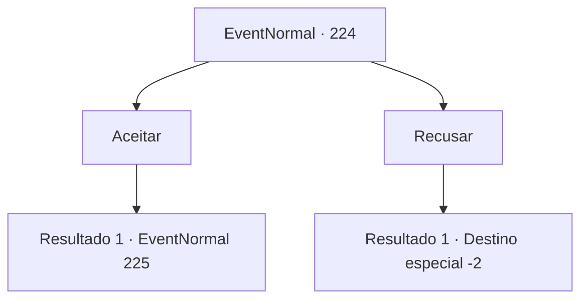

# Eventos normais · 224

[Índice da tabela](index.md) · [Índice geral](../index.md)

ID: `pt:EventNormal:224` · Fonte: `EventNormal4` · Versão: 1.2.47.

Mapeamento estático dos arquivos; a disponibilidade e a execução dependem do estado da run.

## Texto do evento

*Sem texto no arquivo.*

## Dados de entrada

```json
{
  "id": 224,
  "grade": 1,
  "place": "",
  "required": ""
}
```

## Mapa das escolhas



## Escolhas e resultados

### Escolha 1

Aceitar

Requisitos e outros campos da escolha:

```json
{
  "required": ""
}
```

#### Resultado 1.1

O rosto do menino se ilumina quando você diz que vai ajudá-lo. Ele leva você para a rua labiríntica. 

 "Conheço bem esta área! Me siga!"

 Você e o menino vão para o beco da rua. Depois de quase se perder algumas vezes, você finalmente encontra o cachorro perdido, mastigando um osso sujo. 

 "Idiota! Não coma isso! Vamos, garoto!"

 O menino tenta ao máximo atrair a atenção do cachorro, mas o cão parece não querer voltar para ele.

Continuação registrada: [Evento 225](0225.md) na mesma tabela.

```json
{
  "required": "",
  "chance": "1",
  "nextEvent": 225,
  "type": 2,
  "reward": ""
}
```

### Escolha 2

Recusar

Requisitos e outros campos da escolha:

```json
{
  "required": ""
}
```

#### Resultado 2.1

O menino vai encontrar seu cachorro, sozinho, com uma cara de decepção.

Continuação registrada: [Destino especial `-2`](../destinos-especiais.md).

```json
{
  "required": "",
  "chance": "1",
  "nextEvent": -2,
  "type": 2,
  "reward": ""
}
```

## Referências que chegam a este evento

- [Evento 223 · escolha 1 · resultado 1](0223.md#escolha-1)
