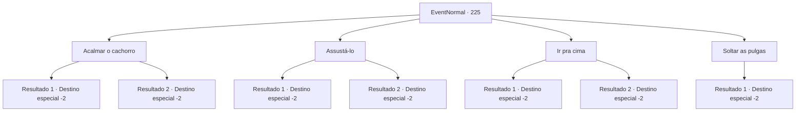

# Eventos normais · 225

[Índice da tabela](index.md) · [Índice geral](../index.md)

ID: `pt:EventNormal:225` · Fonte: `EventNormal4` · Versão: 1.2.47.

Mapeamento estático dos arquivos; a disponibilidade e a execução dependem do estado da run.

## Texto do evento

*Sem texto no arquivo.*

## Dados de entrada

```json
{
  "id": 225,
  "grade": 1,
  "place": "",
  "required": ""
}
```

## Mapa das escolhas



## Escolhas e resultados

### Escolha 1

Acalmar o cachorro

Requisitos e outros campos da escolha:

```json
{
  "required": ""
}
```

#### Resultado 1.1

O cachorro mexe as orelhas por um tempo e vem lentamente em sua direção. Você levanta o cachorro com facilidade e o devolve para o menino. 

 "Obrigado! Aqui... para o seu problema. Por favor, aceite."


Continuação registrada: [Destino especial `-2`](../destinos-especiais.md).

```json
{
  "required": "",
  "chance": "1|0_7_1",
  "nextEvent": -2,
  "type": 0,
  "reward": "3_190_1|0_2_1"
}
```

#### Resultado 1.2

O cachorro mexe as orelhas por um tempo e vem lentamente em sua direção. Pegar o cachorro seria moleza nesse ritmo. Mas assim que você está pensando nisso, o cachorro corre através de você e do menino e desaparece. Tendo perdido o cachorro bem diante de seus olhos, o menino chora. Você não tem escolha a não ser sair do lugar, exausto.

Continuação registrada: [Destino especial `-2`](../destinos-especiais.md).

```json
{
  "required": "",
  "chance": "11",
  "nextEvent": -2,
  "type": 1,
  "reward": ""
}
```

### Escolha 2

Assustá-lo

Requisitos e outros campos da escolha:

```json
{
  "required": ""
}
```

#### Resultado 2.1

Assustado com você, o cachorro enrola o rabo e vem até você. Você levanta o cachorro com facilidade e o devolve para o menino. 

 "Obrigado! Aqui... para o seu problema. Por favor, aceite."


Continuação registrada: [Destino especial `-2`](../destinos-especiais.md).

```json
{
  "required": "",
  "chance": "1|0_12_1",
  "nextEvent": -2,
  "type": 0,
  "reward": "3_190_1|0_2_1"
}
```

#### Resultado 2.2

Assustado, o cachorro enrola o rabo e vem até você. Pegar o cachorro seria moleza nesse ritmo. Mas assim que você pensa nisso, o cachorro corre através de você e do menino e desaparece. Tendo perdido o cachorro bem diante de seus olhos, o menino chora. Você não tem escolha a não ser sair do lugar, exausto.

Continuação registrada: [Destino especial `-2`](../destinos-especiais.md).

```json
{
  "required": "",
  "chance": "12",
  "nextEvent": -2,
  "type": 1,
  "reward": ""
}
```

### Escolha 3

Ir pra cima

Requisitos e outros campos da escolha:

```json
{
  "required": ""
}
```

#### Resultado 3.1

Você pula no cachorro. O cachorro é pego pelo seu movimento ágil, sem sequer ter chance de resistir. Você levanta o cachorro com facilidade e o devolve para o menino. 

 "Obrigado! Aqui... para o seu problema. Por favor, aceite."


Continuação registrada: [Destino especial `-2`](../destinos-especiais.md).

```json
{
  "required": "",
  "chance": "1|0_6_1",
  "nextEvent": -2,
  "type": 0,
  "reward": "3_190_1|0_2_1"
}
```

#### Resultado 3.2

Você pula no cachorro. Mas em vez de pegá-lo, você se joga na parede. Alguns momentos depois, quando sua visão se endireita, o cachorro e o menino se foram.

Continuação registrada: [Destino especial `-2`](../destinos-especiais.md).

```json
{
  "required": "",
  "chance": "10",
  "nextEvent": -2,
  "type": 1,
  "reward": ""
}
```

### Escolha 4

Soltar as pulgas

Requisitos e outros campos da escolha:

```json
{
  "required": "8_4_1"
}
```

#### Resultado 4.1

Você tira sua 'armadura' e o joga no chão enquanto o garoto não está olhando. Algumas pulgas que foram jogadas do couro pulam para o cachorro. Logo, o cachorro começa a se coçar em vez de mastigar o osso, e o menino rapidamente o agarra e o pega. 

 "Ufa, finalmente consegui. Obrigado! Aqui... para o seu problema. Por favor, aceite."


Continuação registrada: [Destino especial `-2`](../destinos-especiais.md).

```json
{
  "required": "",
  "chance": "1",
  "nextEvent": -2,
  "type": 2,
  "reward": "3_190_1|0_3_-1|0_2_1"
}
```

## Referências que chegam a este evento

- [Evento 224 · escolha 1 · resultado 1](0224.md#escolha-1)
