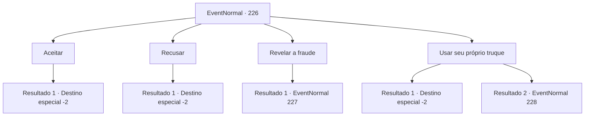

# Eventos normais · 226

[Índice da tabela](index.md) · [Índice geral](../index.md)

ID: `pt:EventNormal:226` · Fonte: `EventNormal4` · Versão: 1.2.47.

Mapeamento estático dos arquivos; a disponibilidade e a execução dependem do estado da run.

## Texto do evento


 "Olhe aqui, pague e receba de volta! Faça sua escolha! Dobre a taxa se acertar!"

 Um charlatão tenta com entusiasmo chamar a atenção das pessoas com uma mesa provisória montada. Suas mãos estão ocupadas movendo as três xícaras pretas sobre a mesa, colocadas de cabeça para baixo. Quando você olha para o lado dele, ele aponta para você com as mãos. 

 "O aventureiro gosta de desafios? A taxa de inscrição é de 100 ouros. Se você encontrar um dos três copos com a bola dentro, receberá o dobro do dinheiro."


## Dados de entrada

```json
{
  "id": 226,
  "grade": 1,
  "place": "",
  "required": "5_160_0"
}
```

## Mapa das escolhas



## Escolhas e resultados

### Escolha 1

Aceitar

Requisitos e outros campos da escolha:

```json
{
  "required": "1_4_100"
}
```

#### Resultado 1.1


 "Uma escolha sábia. Espero que você consiga acertar."

 O charlatão sorri animadamente e se move em torno das xícaras sobre a mesa. 

 "Você pode adivinhar agora."

 Você olha cuidadosamente para os copos e escolhe um, apontando para ele. O interior do copo está totalmente vazio. 

 "Ah, mas que pena. Bom... mais sorte da próxima vez."

 Você sai daquele lugar, tendo perdido o ouro.

Continuação registrada: [Destino especial `-2`](../destinos-especiais.md).

```json
{
  "required": "",
  "chance": "1",
  "nextEvent": -2,
  "type": 2,
  "reward": "0_4_-100"
}
```

### Escolha 2

Recusar

Requisitos e outros campos da escolha:

```json
{
  "required": ""
}
```

#### Resultado 2.1

Você balança a cabeça e vai embora.

Continuação registrada: [Destino especial `-2`](../destinos-especiais.md).

```json
{
  "required": "",
  "chance": "1",
  "nextEvent": -2,
  "type": 2,
  "reward": ""
}
```

### Escolha 3

Revelar a fraude

Requisitos e outros campos da escolha:

```json
{
  "required": "1_7_13"
}
```

#### Resultado 3.1

Você presta atenção nas mãos do charlatão e na mesa, ao contrário de outros que se concentram nas xícaras. Pouco depois, você percebe a bola rolando nas mangas do charlatão, ao invés da taça. Ele ainda não notou seu olhar. Ele corajosamente prossegue com o esquema, enquanto você ainda está olhando.

Continuação registrada: [Evento 227](0227.md) na mesma tabela.

```json
{
  "required": "",
  "chance": "1",
  "nextEvent": 227,
  "type": 2,
  "reward": ""
}
```

### Escolha 4

Usar seu próprio truque

Requisitos e outros campos da escolha:

```json
{
  "required": "1_4_100"
}
```

#### Resultado 4.1

Você paga a taxa de entrada de 100 ouros e senta-se cara a cara com o charlatão. 

 "Uma escolha sábia. Espero que você consiga acertar."

 Você prepara uma bola de aparência semelhante em sua mão e a rola em um dos copos, agindo como se estivesse pegando-a. Quando a bola aparece no copo que você escolheu, o rosto do charlatão fica pálido. 

 "I-Isso...isso não pode estar acontecendo!"

 Ele se levanta de sua cadeira e olha o seu redor, mas a platéia que veio assisti-lo o impede de fugir. O charlatão relutantemente lhe entrega o ouro prometido.

Continuação registrada: [Destino especial `-2`](../destinos-especiais.md).

```json
{
  "required": "",
  "chance": "1|0_6_1",
  "nextEvent": -2,
  "type": 0,
  "reward": "0_4_100|5_160_9"
}
```

#### Resultado 4.2

Você paga a taxa de entrada de 100 ouros e senta-se cara a cara com o charlatão. 

 "Uma escolha sábia. Espero que você consiga acertar."

 Você tenta rolar uma bola de aparência semelhante em um dos copos, mas o charlatão pega seu pulso primeiro. 

 "Pare aí mesmo, meliante. Aposto todo o dinheiro que eu tenho e meu próprio pulso que você tem outra bola falsa na mão."

 Ele joga os copos de lado e se levanta, segurando uma faca na mão.

Continuação registrada: [Evento 228](0228.md) na mesma tabela.

```json
{
  "required": "",
  "chance": "17",
  "nextEvent": 228,
  "type": 1,
  "reward": "0_4_-100|6_0_97",
  "place": 4
}
```

## Referências que chegam a este evento

Nenhum `nextEvent` positivo da mesma tabela aponta para este nó. Isso não prova que seja inacessível: sorteio e estado de história podem selecioná-lo.

