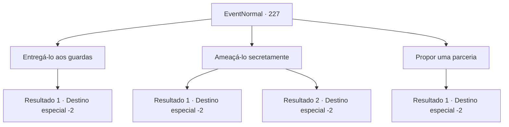

# Eventos normais · 227

[Índice da tabela](index.md) · [Índice geral](../index.md)

ID: `pt:EventNormal:227` · Fonte: `EventNormal4` · Versão: 1.2.47.

Mapeamento estático dos arquivos; a disponibilidade e a execução dependem do estado da run.

## Texto do evento

*Sem texto no arquivo.*

## Dados de entrada

```json
{
  "id": 227,
  "grade": 1,
  "place": "",
  "required": ""
}
```

## Mapa das escolhas



## Escolhas e resultados

### Escolha 1

Entregá-lo aos guardas

Requisitos e outros campos da escolha:

```json
{
  "required": ""
}
```

#### Resultado 1.1

Você percebe um grupo de guardas, que convenientemente está passando. Conforme você conta a eles o que aprendeu, eles prendem o charlatão imediatamente. 

 "Obrigado por informar. Não podemos deixar patifes assim livres por aí."

 O charlatão olha para você enquanto é levado.

Continuação registrada: [Destino especial `-2`](../destinos-especiais.md).

```json
{
  "required": "",
  "chance": "1",
  "nextEvent": -2,
  "type": 2,
  "reward": "0_2_1|0_3_3|5_160_9"
}
```

### Escolha 2

Ameaçá-lo secretamente

Requisitos e outros campos da escolha:

```json
{
  "required": "2_3_0"
}
```

#### Resultado 2.1

Você se aproxima do charlatão e sussurra para ele sobre o que descobriu. Ele olha para você, surpreso. A mão dele fica em torno de sua faca por um momento, mas há muitas pessoas assistindo. 

 "Droga... espertinho. Ei, a julgar pelo fato de que você também sussurrou isso para mim, acho que você não quer que as coisas fiquem confusas tanto quanto eu. Eu te darei isso, e então vamos fingir que isso nunca aconteceu."


Continuação registrada: [Destino especial `-2`](../destinos-especiais.md).

```json
{
  "required": "",
  "chance": "1|0_12_1",
  "nextEvent": -2,
  "type": 0,
  "reward": "3_128_1|5_160_9"
}
```

#### Resultado 2.2

Você sussurra nos ouvidos do charlatão, mas ele apenas sorri. 

 "O que? Eu sei o que você fez? Cai fora, viajante."

 O charlatão volta aos seus negócios. Você tenta sussurrar para ele mais uma vez, mas ele gesticula para você se afastar.

Continuação registrada: [Destino especial `-2`](../destinos-especiais.md).

```json
{
  "required": "",
  "chance": "13",
  "nextEvent": -2,
  "type": 1,
  "reward": "5_160_9"
}
```

### Escolha 3

Propor uma parceria

Requisitos e outros campos da escolha:

```json
{
  "required": "2_3_0"
}
```

#### Resultado 3.1

Você espera até que a multidão diminua e conta ao charlatão sobre o truque que você descobriu. Ele segura o cabo da faca com força, surpreso, e olha para você com cautela. 

 "O que você quer afinal?"

 Quando você diz a ele que está simplesmente procurando uma oportunidade de uma operação conjunta, ele analisa você com seus olhos estreitos. 

 "Hmph. Acho que você tem aptidão e não parece o tipo de pessoa que alerta os guardas."

 Ele concorda, arruma suas coisas e se levanta. 

 "Certo. Porém agora não é a hora, falaremos sobre isso quando nos vermos novamente no futuro."


Continuação registrada: [Destino especial `-2`](../destinos-especiais.md).

```json
{
  "required": "",
  "chance": "1",
  "nextEvent": -2,
  "type": 2,
  "reward": "5_160_1|0_3_-1|0_2_1"
}
```

## Referências que chegam a este evento

- [Evento 226 · escolha 3 · resultado 1](0226.md#escolha-3)
