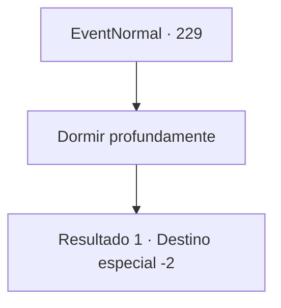

# Eventos normais · 229

[Índice da tabela](index.md) · [Índice geral](../index.md)

ID: `pt:EventNormal:229` · Fonte: `EventNormal4` · Versão: 1.2.47.

Mapeamento estático dos arquivos; a disponibilidade e a execução dependem do estado da run.

## Texto do evento

Enquanto você dorme em um acampamento, você tem um sonho esquisito. Você está cercado por luzes brilhantes, e um anjo protege sua cama a noite toda. 

 "Deus abençoa aqueles que são bons por natureza. Seus esforços serão recompensados."


## Dados de entrada

```json
{
  "id": 229,
  "grade": 1,
  "place": "",
  "required": "1_3_10|5_161_0|20_3_1"
}
```

## Mapa das escolhas



## Escolhas e resultados

### Escolha 1

Dormir profundamente

Requisitos e outros campos da escolha:

```json
{
  "required": ""
}
```

#### Resultado 1.1

De manhã, você acorda com uma sensação muito mais revigorada. Enquanto você está limpando o acampamento, você percebe que há algumas penas brancas no chão ao seu redor.

Continuação registrada: [Destino especial `-2`](../destinos-especiais.md).

```json
{
  "required": "",
  "chance": "1",
  "nextEvent": -2,
  "type": 2,
  "reward": "0_0_1|0_1_1|5_161_1"
}
```

## Referências que chegam a este evento

Nenhum `nextEvent` positivo da mesma tabela aponta para este nó. Isso não prova que seja inacessível: sorteio e estado de história podem selecioná-lo.

