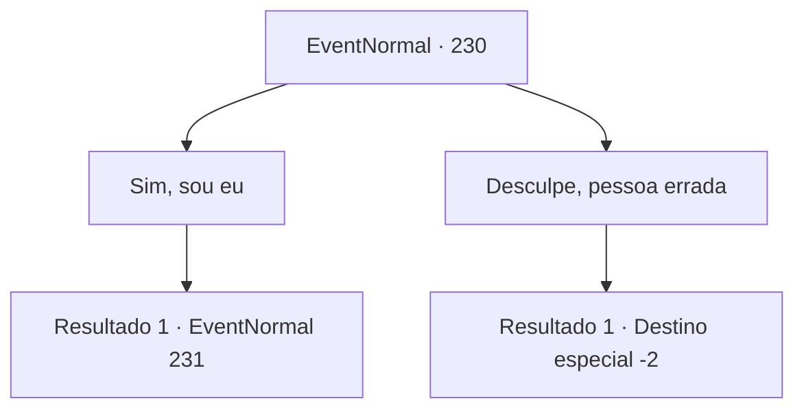

# Eventos normais · 230

[Índice da tabela](index.md) · [Índice geral](../index.md)

ID: `pt:EventNormal:230` · Fonte: `EventNormal4` · Versão: 1.2.47.

Mapeamento estático dos arquivos; a disponibilidade e a execução dependem do estado da run.

## Texto do evento

Enquanto você faz uma refeição em uma pousada da cidade, um grupo de pessoas entra na sala. A julgar por sua roupa, eles devem ser os sacerdotes de um templo próximo. O olhar deles encontra você enquanto procuram uma mesa vazia. 

 "É quem procuramos..."

 Eles conversam um com o outro por um momento e se aproximam de você. 

 "Você deve ser {1}, certo? Você é popular até mesmo entre os sacerdotes do templo. É uma honra te conhecer."


## Dados de entrada

```json
{
  "id": 230,
  "grade": 1,
  "place": "",
  "required": "1_3_25|1_2_50|5_162_0"
}
```

## Mapa das escolhas



## Escolhas e resultados

### Escolha 1

Sim, sou eu

Requisitos e outros campos da escolha:

```json
{
  "required": ""
}
```

#### Resultado 1.1


 "É claro!"

 Eles olham para você com olhos cheios de admiração. 

 "Nós sempre quisemos conhecê-lo pessoalmente algum dia. Isso é ótimo, podemos conversar um pouco?"

 Você conversa ociosamente com os padres por algumas horas. 

 "Ah, olha a hora."

 "Acho que devemos ir logo. Se isso não te incomoda, estimado {1}, adoraríamos ouvir uma de suas histórias de aventuras."


Continuação registrada: [Evento 231](0231.md) na mesma tabela.

```json
{
  "required": "",
  "chance": "1",
  "nextEvent": 231,
  "type": 2,
  "reward": "5_162_1"
}
```

### Escolha 2

Desculpe, pessoa errada

Requisitos e outros campos da escolha:

```json
{
  "required": ""
}
```

#### Resultado 2.1

Os padres parecem não acreditar em você. Mas eles não o incomodam mais. 

 "Muito bem. Vamos partir agora. Passar bem."


Continuação registrada: [Destino especial `-2`](../destinos-especiais.md).

```json
{
  "required": "",
  "chance": "1",
  "nextEvent": -2,
  "type": 2,
  "reward": "5_162_1"
}
```

## Referências que chegam a este evento

Nenhum `nextEvent` positivo da mesma tabela aponta para este nó. Isso não prova que seja inacessível: sorteio e estado de história podem selecioná-lo.

