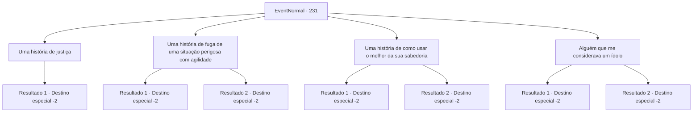

# Eventos normais · 231

[Índice da tabela](index.md) · [Índice geral](../index.md)

ID: `pt:EventNormal:231` · Fonte: `EventNormal4` · Versão: 1.2.47.

Mapeamento estático dos arquivos; a disponibilidade e a execução dependem do estado da run.

## Texto do evento

*Sem texto no arquivo.*

## Dados de entrada

```json
{
  "id": 231,
  "grade": 1,
  "place": "",
  "required": ""
}
```

## Mapa das escolhas



## Escolhas e resultados

### Escolha 1

Uma história de justiça

Requisitos e outros campos da escolha:

```json
{
  "required": ""
}
```

#### Resultado 1.1

Você conta a eles uma história sobre quando você cumpriu a justiça com sua força. Mas, aparentemente, a história não é agradável para os padres. Eles ouvem por um tempo e vão embora às pressas.

Continuação registrada: [Destino especial `-2`](../destinos-especiais.md).

```json
{
  "required": "",
  "chance": "1",
  "nextEvent": -2,
  "type": 2,
  "reward": "5_162_1"
}
```

### Escolha 2

Uma história de fuga de uma situação perigosa com agilidade

Requisitos e outros campos da escolha:

```json
{
  "required": ""
}
```

#### Resultado 2.1

Você conta a eles uma história sobre quando você bloqueou o caminho de fuga de ladrões armados com sua agilidade. 

 "Incrível. Pessoas como você e seus feitos tornam esta área muito mais segura, certo? Isso é algo que um aventureiro doou ao nosso templo. Seria uma honra se você o usasse."

 Os padres deixam algo para a história e vão embora.

Continuação registrada: [Destino especial `-2`](../destinos-especiais.md).

```json
{
  "required": "1_6_14",
  "chance": "1",
  "nextEvent": -2,
  "type": 2,
  "reward": "3_129_1|0_2_1|5_162_1"
}
```

#### Resultado 2.2

Você conta a eles uma história sobre quando tentou bloquear o caminho de fuga de ladrões armados com sua agilidade. Enquanto você está contando a história, você se lembra que a história é sobre um fracasso, não um sucesso. Os sacerdotes acenam com a cabeça formalmente e vão embora.

Continuação registrada: [Destino especial `-2`](../destinos-especiais.md).

```json
{
  "required": "2_6_14",
  "chance": "1",
  "nextEvent": -2,
  "type": 2,
  "reward": "5_162_1"
}
```

### Escolha 3

Uma história de como usar o melhor da sua sabedoria

Requisitos e outros campos da escolha:

```json
{
  "required": ""
}
```

#### Resultado 3.1

Você conta a eles uma história sobre iluminar as pessoas com sua sabedoria. 

 "Palavras sábias. Um discurso exemplar. Aqui tem algo que um aventureiro doou ao nosso templo. Seria uma honra se você o usasse."

 Os padres deixam algo para a história e vão embora.

Continuação registrada: [Destino especial `-2`](../destinos-especiais.md).

```json
{
  "required": "",
  "chance": "1|0_14_1",
  "nextEvent": -2,
  "type": 0,
  "reward": "3_129_1|0_2_1|5_162_1"
}
```

#### Resultado 3.2

O início de sua história é ótimo, mas conforme você avança, suas palavras se confundem. Em seu capítulo final, a história é completamente diferente de como você começou. Os sacerdotes acenam com a cabeça formalmente e vão embora.

Continuação registrada: [Destino especial `-2`](../destinos-especiais.md).

```json
{
  "required": "",
  "chance": "14",
  "nextEvent": -2,
  "type": 1,
  "reward": "5_162_1"
}
```

### Escolha 4

Alguém que me considerava um ídolo

Requisitos e outros campos da escolha:

```json
{
  "required": ""
}
```

#### Resultado 4.1

Você conta a eles uma história sobre um garotinho que decidiu fazer de você seu ídolo. 

 "Você influenciou positivamente as mentes mais jovens. Isso é bom. Isso é algo que um aventureiro doou ao nosso templo. Seria uma honra se você o usasse."

 Os padres deixam algo para a história e vão embora.

Continuação registrada: [Destino especial `-2`](../destinos-especiais.md).

```json
{
  "required": "",
  "chance": "1|0_12_1",
  "nextEvent": -2,
  "type": 0,
  "reward": "3_129_1|0_2_1|5_162_1"
}
```

#### Resultado 4.2

Você conta a eles uma história sobre um garotinho que decidiu fazer de você seu ídolo. Depois de ouvir a história, os sacerdotes viram a cabeça em confusão. 

 "Talvez você estivesse infundindo-lhes sonhos falsos... ah, obrigado por suas palavras, de qualquer maneira."

 Eles se despedem e vão embora.

Continuação registrada: [Destino especial `-2`](../destinos-especiais.md).

```json
{
  "required": "",
  "chance": "12",
  "nextEvent": -2,
  "type": 1,
  "reward": "5_162_1"
}
```

## Referências que chegam a este evento

- [Evento 230 · escolha 1 · resultado 1](0230.md#escolha-1)
