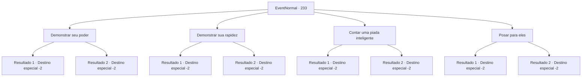

# Eventos normais · 233

[Índice da tabela](index.md) · [Índice geral](../index.md)

ID: `pt:EventNormal:233` · Fonte: `EventNormal4` · Versão: 1.2.47.

Mapeamento estático dos arquivos; a disponibilidade e a execução dependem do estado da run.

## Texto do evento

*Sem texto no arquivo.*

## Dados de entrada

```json
{
  "id": 233,
  "grade": 1,
  "place": "",
  "required": ""
}
```

## Mapa das escolhas



## Escolhas e resultados

### Escolha 1

Demonstrar seu poder

Requisitos e outros campos da escolha:

```json
{
  "required": ""
}
```

#### Resultado 1.1

Você pega uma maçã da mesa e a aperta com toda a sua força. A maçã é esmagada em pedaços. 

 "Uau isso é incrível! Este é um presente nosso. Nós o pegamos em nossa aventura, mas nem sabemos como usá-lo corretamente. Acho que você, {1}, que tem muita experiência, deveria ficar com ele."

 Eles vão embora, alegremente falando de você.

Continuação registrada: [Destino especial `-2`](../destinos-especiais.md).

```json
{
  "required": "",
  "chance": "1|0_5_1",
  "nextEvent": -2,
  "type": 0,
  "reward": "3_101_1|5_162_1|0_2_1"
}
```

#### Resultado 1.2

Você pega uma maçã da mesa e a aperta com toda a força. Mas a maçã não cede. 

 "Haha. Talvez você não esteja na condição certa hoje."

 Eles vão embora, falando de você.

Continuação registrada: [Destino especial `-2`](../destinos-especiais.md).

```json
{
  "required": "",
  "chance": "8",
  "nextEvent": -2,
  "type": 1,
  "reward": "5_162_1"
}
```

### Escolha 2

Demonstrar sua rapidez

Requisitos e outros campos da escolha:

```json
{
  "required": ""
}
```

#### Resultado 2.1

Você pega emprestado alguns dos punhais dos aventureiros e começa a fazer malabarismos com eles. 

 "Incrível! Este é um presente nosso. Nós o pegamos em nossa aventura, mas nem sabemos como usá-lo corretamente. Acho que você, {1}, que tem muita experiência, deveria ficar com ele."

 Eles vão embora, alegremente falando de você.

Continuação registrada: [Destino especial `-2`](../destinos-especiais.md).

```json
{
  "required": "",
  "chance": "1|0_6_1",
  "nextEvent": -2,
  "type": 0,
  "reward": "3_101_1|5_162_1|0_2_1"
}
```

#### Resultado 2.2

Você pega emprestado alguns dos punhais dos aventureiros e começa a fazer malabarismos com eles. Mas os punhais caem na mesa em frangalhos. 

 "Haha. Talvez você não esteja na condição certa hoje."

 Eles vão embora, falando de você.

Continuação registrada: [Destino especial `-2`](../destinos-especiais.md).

```json
{
  "required": "",
  "chance": "8",
  "nextEvent": -2,
  "type": 1,
  "reward": "5_162_1"
}
```

### Escolha 3

Contar uma piada inteligente

Requisitos e outros campos da escolha:

```json
{
  "required": ""
}
```

#### Resultado 3.1

Você dá alguns conselhos que os ajudarão em suas aventuras, cobre com piadas espirituosas e entrega a eles. Os aventureiros caem na gargalhada. 

 "Foi uma honra conhecê-lo hoje. Este é um presente nosso. Nós o pegamos em nossa aventura, mas nem sabemos como usá-lo corretamente. Acho que você, {1}, que tem muita experiência, deveria ficar com ele."

 Eles vão embora, alegremente falando de você.

Continuação registrada: [Destino especial `-2`](../destinos-especiais.md).

```json
{
  "required": "",
  "chance": "1|0_7_1",
  "nextEvent": -2,
  "type": 0,
  "reward": "3_101_1|5_162_1|0_2_1"
}
```

#### Resultado 3.2

Você dá alguns conselhos que os ajudarão em suas aventuras, cobre com piadas espirituosas e entrega a eles. Mas parece que os aventureiros não entendem a piada. 

 "Humm... pode haver uma perspectiva como essa, eu acho. Agora, se você nos der licença."

 Eles vão embora, falando de você.

Continuação registrada: [Destino especial `-2`](../destinos-especiais.md).

```json
{
  "required": "",
  "chance": "8",
  "nextEvent": -2,
  "type": 1,
  "reward": "5_162_1"
}
```

### Escolha 4

Posar para eles

Requisitos e outros campos da escolha:

```json
{
  "required": ""
}
```

#### Resultado 4.1

Você posa com graça, como se um bardo ou um ator faria na frente de uma platéia. Eles batem palmas, apreciando a visão. 

 "Hahaha!! Incrível. Este é um presente nosso. Nós o pegamos em nossa aventura, mas nem sabemos como usá-lo corretamente. Acho que você, {1}, que tem muita experiência, deveria ter."

 Eles vão embora, alegremente falando de você.

Continuação registrada: [Destino especial `-2`](../destinos-especiais.md).

```json
{
  "required": "",
  "chance": "1|0_12_1",
  "nextEvent": -2,
  "type": 0,
  "reward": "3_101_1|5_162_1|0_2_1"
}
```

#### Resultado 4.2

Você posa com graça, como se um bardo ou um ator faria na frente de uma platéia. Os aventureiros se encaram, envergonhados. 

 "R...certo... Isso é ótimo. Agora se você nos der licença .."

 

Continuação registrada: [Destino especial `-2`](../destinos-especiais.md).

```json
{
  "required": "",
  "chance": "8",
  "nextEvent": -2,
  "type": 1,
  "reward": "5_162_1"
}
```

## Referências que chegam a este evento

- [Evento 232 · escolha 1 · resultado 1](0232.md#escolha-1)
