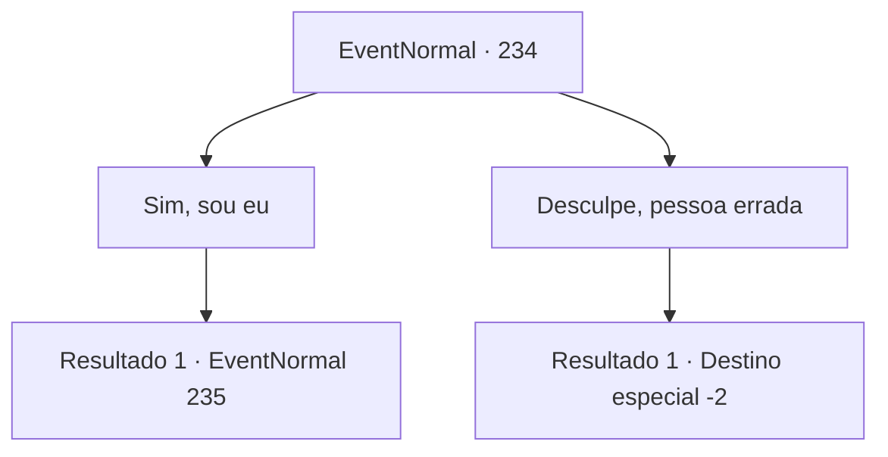

# Eventos normais · 234

[Índice da tabela](index.md) · [Índice geral](../index.md)

ID: `pt:EventNormal:234` · Fonte: `EventNormal4` · Versão: 1.2.47.

Mapeamento estático dos arquivos; a disponibilidade e a execução dependem do estado da run.

## Texto do evento

Enquanto você faz uma refeição em uma pousada da cidade, um grupo de pessoas entra na sala. A julgar por seu comportamento de bandido, parece que eles são membros de uma gangue que dizem ser os donos da vizinhança. O olhar deles encontra você enquanto procuram uma mesa vazia. 

 "É quem procuramos..."

 Eles conversam um com o outro por um momento e se aproximam de você. 

 "Você é {1}, certo? Nós te consideramos nosso ídolo. É aqui que dizemos que é uma honra te conhecer?"


## Dados de entrada

```json
{
  "id": 234,
  "grade": 1,
  "place": "",
  "required": "2_3_-14|1_2_50|5_162_0"
}
```

## Mapa das escolhas



## Escolhas e resultados

### Escolha 1

Sim, sou eu

Requisitos e outros campos da escolha:

```json
{
  "required": ""
}
```

#### Resultado 1.1


 "É claro!"

 Eles olham para você com olhos cheios de admiração. 

 "Nós sempre quisemos conhecê-lo pessoalmente algum dia. Isso é ótimo, por que não conversamos por um momento?"

 Você conta a eles histórias de suas ações malignas. Os bandidos ouvem suas histórias com alegria. Eles batem palmas em admiração. 

 "Você realmente é alguma coisa. Você realmente fez isso?"

 "Como vivemos uma vida como a sua? Ensine-nos algo. Também queremos saber."


Continuação registrada: [Evento 235](0235.md) na mesma tabela.

```json
{
  "required": "",
  "chance": "1",
  "nextEvent": 235,
  "type": 2,
  "reward": "5_162_1"
}
```

### Escolha 2

Desculpe, pessoa errada

Requisitos e outros campos da escolha:

```json
{
  "required": ""
}
```

#### Resultado 2.1

Os bandidos parecem não acreditar em você. Mas eles não te incomodam mais. 

 "Tudo bem, você não é essa pessoa então. Você é mais covarde do que pensávamos."

 Eles saem, fazendo comentários sarcásticos ..

Continuação registrada: [Destino especial `-2`](../destinos-especiais.md).

```json
{
  "required": "",
  "chance": "1",
  "nextEvent": -2,
  "type": 2,
  "reward": "5_162_1"
}
```

## Referências que chegam a este evento

Nenhum `nextEvent` positivo da mesma tabela aponta para este nó. Isso não prova que seja inacessível: sorteio e estado de história podem selecioná-lo.

