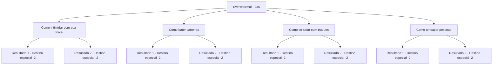

# Eventos normais · 235

[Índice da tabela](index.md) · [Índice geral](../index.md)

ID: `pt:EventNormal:235` · Fonte: `EventNormal4` · Versão: 1.2.47.

Mapeamento estático dos arquivos; a disponibilidade e a execução dependem do estado da run.

## Texto do evento

*Sem texto no arquivo.*

## Dados de entrada

```json
{
  "id": 235,
  "grade": 1,
  "place": "",
  "required": ""
}
```

## Mapa das escolhas



## Escolhas e resultados

### Escolha 1

Como intimidar com sua força

Requisitos e outros campos da escolha:

```json
{
  "required": ""
}
```

#### Resultado 1.1

Você pega uma maçã da mesa e a esmaga, avisando que a intimidação pela força é sempre uma opção válida. 

 "Vamos seguir esse conselho. Isso é nosso, pegue."

 Os bandidos lhe entregam uma pequena bolsa e vão embora. 

Continuação registrada: [Destino especial `-2`](../destinos-especiais.md).

```json
{
  "required": "",
  "chance": "1|0_5_1",
  "nextEvent": -2,
  "type": 0,
  "reward": "3_45_1|0_2_1|5_162_1"
}
```

#### Resultado 1.2

Você tenta pegar uma maçã da mesa e esmagá-la, mas a maçã não cede. 

 "Huh, você não é muito, afinal."

 Os bandidos riem de você e vão embora.

Continuação registrada: [Destino especial `-2`](../destinos-especiais.md).

```json
{
  "required": "",
  "chance": "8",
  "nextEvent": -2,
  "type": 1,
  "reward": "5_162_1"
}
```

### Escolha 2

Como bater carteiras

Requisitos e outros campos da escolha:

```json
{
  "required": ""
}
```

#### Resultado 2.1

Você rouba moedas dos bolsos dos bandidos sem que eles percebam e as devolve. Eles colocam as mãos nos bolsos com espanto, e logo te elogiam com admiração. 

 "Mas você estava bem na nossa frente."

 Você ensina algumas dicas simples sobre batedores de carteira. 

 "Vamos seguir esse conselho. Isso é nosso, pegue."

 Os bandidos lhe entregam uma pequena bolsa e vão embora.

Continuação registrada: [Destino especial `-2`](../destinos-especiais.md).

```json
{
  "required": "",
  "chance": "1|0_6_1",
  "nextEvent": -2,
  "type": 0,
  "reward": "3_45_1|0_2_1|5_162_1"
}
```

#### Resultado 2.2

Você tenta mostrar a eles como bater carteiras, mas falha miseravelmente. 

 "Huh, você não é tão bom, no fim das contas."

 Os bandidos riem de você e vão embora.

Continuação registrada: [Destino especial `-2`](../destinos-especiais.md).

```json
{
  "required": "",
  "chance": "8",
  "nextEvent": -2,
  "type": 1,
  "reward": "5_162_1"
}
```

### Escolha 3

Como se safar com truques

Requisitos e outros campos da escolha:

```json
{
  "required": ""
}
```

#### Resultado 3.1

Você os ensina a enganar as pessoas com palavras. 

 "Vamos seguir esse conselho. Isso é nosso, pegue."

 Os bandidos lhe entregam uma pequena bolsa e vão embora.

Continuação registrada: [Destino especial `-2`](../destinos-especiais.md).

```json
{
  "required": "",
  "chance": "1|0_7_1",
  "nextEvent": -2,
  "type": 0,
  "reward": "3_45_1|0_2_1|5_162_1"
}
```

#### Resultado 3.2

Você tenta ensiná-los a enganar as pessoas com palavras, mas eles balançam a cabeça. 

 "Nós não somos farsantes que enganam outras pessoas com palavras."

 Os bandidos riem de você e vão embora.

Continuação registrada: [Destino especial `-2`](../destinos-especiais.md).

```json
{
  "required": "",
  "chance": "8",
  "nextEvent": -2,
  "type": 1,
  "reward": "5_162_1"
}
```

### Escolha 4

Como ameaçar pessoas

Requisitos e outros campos da escolha:

```json
{
  "required": ""
}
```

#### Resultado 4.1

Você encara os bandidos com um olhar intimidador. Eles se encolhem em sua aura. 

 "E-e agora?"

 Você conserta sua postura de forma confortável novamente e diz a eles que pessoas esmagadoras como essa serão muito eficazes. 

 "...Entendo. Bela demonstração. Isso é nosso, pegue."

 Os bandidos lhe entregam uma pequena bolsa e vão embora.

Continuação registrada: [Destino especial `-2`](../destinos-especiais.md).

```json
{
  "required": "",
  "chance": "1|0_12_1",
  "nextEvent": -2,
  "type": 0,
  "reward": "3_45_1|0_2_1|5_162_1"
}
```

#### Resultado 4.2

Você endireita a parte superior do corpo e encara os bandidos. Mas eles apenas sorriem para você, pensando que você está fazendo uma piada. 

 "O que? Não tem mais nada pra falar? É isso?"

 Os bandidos riem de você e vão embora.

Continuação registrada: [Destino especial `-2`](../destinos-especiais.md).

```json
{
  "required": "",
  "chance": "8",
  "nextEvent": -2,
  "type": 1,
  "reward": "5_162_1"
}
```

## Referências que chegam a este evento

- [Evento 234 · escolha 1 · resultado 1](0234.md#escolha-1)
