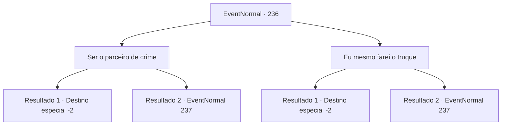

# Eventos normais · 236

[Índice da tabela](index.md) · [Índice geral](../index.md)

ID: `pt:EventNormal:236` · Fonte: `EventNormal4` · Versão: 1.2.47.

Mapeamento estático dos arquivos; a disponibilidade e a execução dependem do estado da run.

## Texto do evento

Você se encontra de novo com o charlatão. 

 "Ah, é você. Na verdade, estava procurando um parceiro de crime. O que você me diz?"

 Ele aponta para uma praça da cidade, com um mercado bem grande. 

 "Consegui descobrir um bom lugar. O trabalho seria muito mais fácil com um parceiro. Posso contar contigo?"


## Dados de entrada

```json
{
  "id": 236,
  "grade": 1,
  "place": "",
  "required": "5_160_1|0_3_-1|0_2_1"
}
```

## Mapa das escolhas



## Escolhas e resultados

### Escolha 1

Ser o parceiro de crime

Requisitos e outros campos da escolha:

```json
{
  "required": ""
}
```

#### Resultado 1.1


 "Tudo bem. Quando as coisas não esquentam, você vem aqui como se fosse um cliente e esquenta as coisas. Melhor ainda se você trouxer alguns clientes estúpidos."

 Você começa seu papel como ala na frente do charlatão. Sua língua de prata arrecada dinheiro da multidão, sem que eles percebam que estão perdendo dinheiro. Cada pessoa na multidão perde dinheiro, mas ninguém suspeita de você e do charlatão. 

 "Haha! Veja quanto ganhamos hoje! Aqui. Esta é a sua parte."

 O charlatão lhe entrega alegremente as moedas de ouro. 

 "Eu poderia matar para fazer todos os dias serem como hoje. Adeus, viajante. E não seja pego."


Continuação registrada: [Destino especial `-2`](../destinos-especiais.md).

```json
{
  "required": "",
  "chance": "1|0_12_1",
  "nextEvent": -2,
  "type": 0,
  "reward": "0_4_200|0_3_-3|5_160_2|0_2_1"
}
```

#### Resultado 1.2


 "Tudo bem. Quando as coisas não dão certo, você vem aqui como se fosse um cliente e esquenta as coisas. Melhor ainda se você trouxer alguns clientes otários."

 Você começa seu papel como parceiro na frente do charlatão. Você tenta o seu melhor para atrair clientes por um tempo, mas sua sorte não é grande hoje. Um dos comerciantes que perderam dinheiro com o golpe aponta para você e grita. 

 "Espera aí! Você... eu vi você conversando com o charlatão! Guardas!!!"

 Guardas próximos correm para você e logo você está cercado. Você olha para trás, mas o charlatão não está em mais lá, presumivelmente já tendo fugido.

Continuação registrada: [Evento 237](0237.md) na mesma tabela.

```json
{
  "required": "",
  "chance": "13",
  "nextEvent": 237,
  "type": 1,
  "reward": "6_0_21|5_160_2",
  "place": 4
}
```

### Escolha 2

Eu mesmo farei o truque

Requisitos e outros campos da escolha:

```json
{
  "required": ""
}
```

#### Resultado 2.1


 "É mesmo? Então eu serei o parceiro. Esta linha de trabalho precisa de movimentos rápidos das mãos, então tenha cuidado."

 O charlatão passa para você seu assento. Você toma seu lugar na cadeira e começa a lidar com os clientes. Seus movimentos de mão rápidos ganham dinheiro, sem que eles percebam que estão perdendo dinheiro. Cada pessoa na multidão perde dinheiro, mas ninguém suspeita de você e do charlatão. 

 "Haha! Veja quanto ganhamos hoje! Aqui. Esta é a sua parte."

 O charlatão lhe entrega alegremente as moedas de ouro. 

 "Eu mataria por mais dias como hoje. Adeus. E não seja pego."


Continuação registrada: [Destino especial `-2`](../destinos-especiais.md).

```json
{
  "required": "",
  "chance": "1|0_6_1",
  "nextEvent": -2,
  "type": 0,
  "reward": "0_4_200|0_3_-3|5_160_2|0_2_1"
}
```

#### Resultado 2.2


 "É mesmo? Então eu serei o parceiro. Esta linha de trabalho precisa de movimentos rápidos das mãos, então tenha cuidado."

 O charlatão passa para você seu assento. Você toma seu lugar na cadeira. Você tenta o seu melhor para esconder a bola com os movimentos das mãos, mas sua sorte não é boa hoje. Um dos comerciantes que perderam dinheiro com o golpe aponta para você e grita. 

 "Espere aí! Tire essa coisa de dentro de suas mangas! Eu vi você escondendo algo aí! Guardas!!!"

 Guardas próximos correm para você e logo você está cercado. Você olha para trás, mas o charlatão não está mais lá, presumivelmente já tendo fugido.

Continuação registrada: [Evento 237](0237.md) na mesma tabela.

```json
{
  "required": "",
  "chance": "15",
  "nextEvent": 237,
  "type": 1,
  "reward": "6_0_21|5_160_2",
  "place": 4
}
```

## Referências que chegam a este evento

Nenhum `nextEvent` positivo da mesma tabela aponta para este nó. Isso não prova que seja inacessível: sorteio e estado de história podem selecioná-lo.

