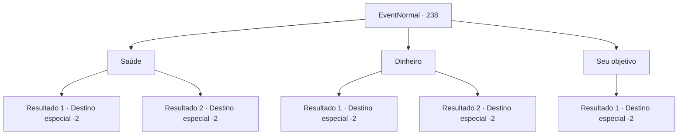

# Eventos normais · 238

[Índice da tabela](index.md) · [Índice geral](../index.md)

ID: `pt:EventNormal:238` · Fonte: `EventNormal4` · Versão: 1.2.47.

Mapeamento estático dos arquivos; a disponibilidade e a execução dependem do estado da run.

## Texto do evento

Você olha para o céu noturno, enquanto acende sua fogueira. A bela vista, que lembra um vestido preto chique decorado com joias brilhantes, é o suficiente para deslumbrar você. Enquanto você olha para o céu noturno, você vê uma estrela cadente caindo. Depois de olhar para a estrela, você rapidamente faz um pedido.

## Dados de entrada

```json
{
  "id": 238,
  "grade": 1,
  "place": "",
  "required": "5_165_0"
}
```

## Mapa das escolhas



## Escolhas e resultados

### Escolha 1

Saúde

Requisitos e outros campos da escolha:

```json
{
  "required": ""
}
```

#### Resultado 1.1

Você pede saúde para que possa continuar suas aventuras de forma segura no futuro. Você pensa consigo mesmo que seu bem-estar é o bem mais valioso. No dia seguinte, depois de abrir os olhos, você continua sua aventura, e agora seu corpo está muito mais leve.

Continuação registrada: [Destino especial `-2`](../destinos-especiais.md).

```json
{
  "required": "",
  "chance": "1",
  "nextEvent": -2,
  "type": 2,
  "reward": "0_0_1|5_165_1"
}
```

#### Resultado 1.2

Você pede saúde para que possa continuar suas aventuras de forma segura no futuro.  Você pensa consigo mesmo que seu bem-estar é o bem mais valioso. No dia seguinte, ao contrário do que você desejava, você acorda com o corpo todo machucado e espancado.

Continuação registrada: [Destino especial `-2`](../destinos-especiais.md).

```json
{
  "required": "",
  "chance": "1",
  "nextEvent": -2,
  "type": 2,
  "reward": "5_165_1"
}
```

### Escolha 2

Dinheiro

Requisitos e outros campos da escolha:

```json
{
  "required": ""
}
```

#### Resultado 2.1

Você deseja um futuro financeiramente produtivo. Você pensa consigo mesmo que o dinheiro é a coisa mais importante na vida. No dia seguinte, depois de abrir os olhos, você encontra algumas moedas de ouro na rua.

Continuação registrada: [Destino especial `-2`](../destinos-especiais.md).

```json
{
  "required": "",
  "chance": "1",
  "nextEvent": -2,
  "type": 2,
  "reward": "0_4_10|5_165_2"
}
```

#### Resultado 2.2

Você deseja um futuro financeiramente produtivo. Você pensa consigo mesmo que o dinheiro é a coisa mais importante na vida. No dia seguinte, depois de abrir os olhos, você caminha com os olhos fixos no chão para encontrar algo, mas você não acha nada.

Continuação registrada: [Destino especial `-2`](../destinos-especiais.md).

```json
{
  "required": "",
  "chance": "1",
  "nextEvent": -2,
  "type": 2,
  "reward": "5_165_2"
}
```

### Escolha 3

Seu objetivo

Requisitos e outros campos da escolha:

```json
{
  "required": ""
}
```

#### Resultado 3.1

Você deseja um caminho para alcançar seu objetivo. Você pensa consigo mesmo que sonhos e objetivos são a maior motivação para qualquer aventureiro. No dia seguinte, você abre os olhos e retoma a aventura, lembrando o que desejou na noite passada.

Continuação registrada: [Destino especial `-2`](../destinos-especiais.md).

```json
{
  "required": "",
  "chance": "1",
  "nextEvent": -2,
  "type": 2,
  "reward": "5_165_3"
}
```

## Referências que chegam a este evento

Nenhum `nextEvent` positivo da mesma tabela aponta para este nó. Isso não prova que seja inacessível: sorteio e estado de história podem selecioná-lo.

