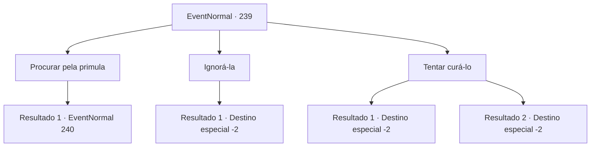

# Eventos normais · 239

[Índice da tabela](index.md) · [Índice geral](../index.md)

ID: `pt:EventNormal:239` · Fonte: `EventNormal4` · Versão: 1.2.47.

Mapeamento estático dos arquivos; a disponibilidade e a execução dependem do estado da run.

## Texto do evento

Ao visitar uma pequena vila no interior para descansar, você encontra uma garotinha soltando um longo suspiro. Quando você pergunta a ela qual é o problema, ela fala com uma expressão preocupada. 

 "É meu pai... Ele está doente há dez dias, mas não parece estar melhorando."

 Ela cuidadosamente pergunta a você. 

 "Ouvi dizer que uma flor chamada primula é o remédio para a doença dele... você pode me ajudar?"


## Dados de entrada

```json
{
  "id": 239,
  "grade": 1,
  "place": "",
  "required": "5_164_0"
}
```

## Mapa das escolhas



## Escolhas e resultados

### Escolha 1

Procurar pela primula

Requisitos e outros campos da escolha:

```json
{
  "required": ""
}
```

#### Resultado 1.1

Quando você diz a ela que vai voltar com a flor do sol, ela sorri feliz e pega sua mão. 

 "Muito obrigada! Dizem que as flores do sol florescem na beira daquele penhasco no topo da montanha, então tenha cuidado!"

 Você ouve a descrição da menina sobre a flor do sol e sobe a montanha em busca dela. Depois de um tempo, você recupera o fôlego e finalmente chega ao topo da montanha. Quando você procura o lugar que a garota lhe disse, você encontra a flor na beira de um penhasco. Você olha para baixo do penhasco e vê um lago fluindo rapidamente. Você sente o suor nas costas, pressentindo instintivamente o perigo.

Continuação registrada: [Evento 240](0240.md) na mesma tabela.

```json
{
  "required": "",
  "chance": "1",
  "nextEvent": 240,
  "type": 2,
  "reward": ""
}
```

### Escolha 2

Ignorá-la

Requisitos e outros campos da escolha:

```json
{
  "required": ""
}
```

#### Resultado 2.1

Você não quer arriscar nada, então decide ignorá-la. A garota resmunga como se quisesse dizer alguma coisa, mas logo ela te deixa.

Continuação registrada: [Destino especial `-2`](../destinos-especiais.md).

```json
{
  "required": "",
  "chance": "1",
  "nextEvent": -2,
  "type": 2,
  "reward": "5_164_1"
}
```

### Escolha 3

Tentar curá-lo

Requisitos e outros campos da escolha:

```json
{
  "required": ""
}
```

#### Resultado 3.1

Você mistura habilmente as ervas medicinais que encontrou perto da aldeia e cura o pai da menina. Depois de tomar o remédio, sua aparência fica visivelmente melhor e, no dia seguinte, ele está completamente curado. Ele te pega pela mão e fala, depois de acordar. 

 "Oh! Obrigado! Como posso te agradecer?!"

 Após uma cuidadosa consideração, ele pega uma das espadas da casa e entrega a você. 

 "Esta espada foi a que eu usei na minha juventude quando eu era um soldado, e espero que você possa usá-la bem."

 Você pega e continua em sua aventura.

Continuação registrada: [Destino especial `-2`](../destinos-especiais.md).

```json
{
  "required": "",
  "chance": "1|0_7_1",
  "nextEvent": -2,
  "type": 0,
  "reward": "3_19_1|0_2_1|5_164_2"
}
```

#### Resultado 3.2

Você diz com confiança à garota que você vai curar o pai dela sozinho. Ela parece um pouco preocupada, mas ainda leva você até ele. No entanto, a única coisa que você aprendeu foi que seu conhecimento é insuficiente para curá-lo. Ela olha para você com um olhar rancoroso, e você sai da casa dela sem jeito.

Continuação registrada: [Destino especial `-2`](../destinos-especiais.md).

```json
{
  "required": "",
  "chance": "15",
  "nextEvent": -2,
  "type": 1,
  "reward": "5_164_1"
}
```

## Referências que chegam a este evento

Nenhum `nextEvent` positivo da mesma tabela aponta para este nó. Isso não prova que seja inacessível: sorteio e estado de história podem selecioná-lo.

