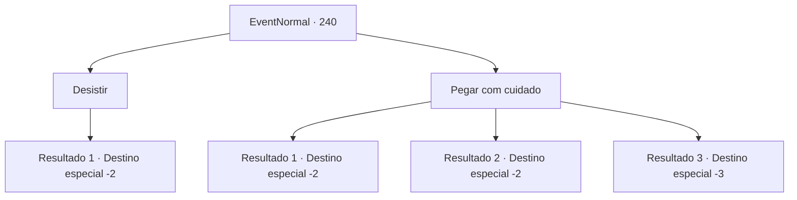

# Eventos normais · 240

[Índice da tabela](index.md) · [Índice geral](../index.md)

ID: `pt:EventNormal:240` · Fonte: `EventNormal4` · Versão: 1.2.47.

Mapeamento estático dos arquivos; a disponibilidade e a execução dependem do estado da run.

## Texto do evento

*Sem texto no arquivo.*

## Dados de entrada

```json
{
  "id": 240,
  "grade": 1,
  "place": "",
  "required": ""
}
```

## Mapa das escolhas



## Escolhas e resultados

### Escolha 1

Desistir

Requisitos e outros campos da escolha:

```json
{
  "required": ""
}
```

#### Resultado 1.1

Você desiste de colher a flor do sol e desce a montanha. A garota te olha com os olhos esperançosos, mas logo sai decepcionada quando ela percebe que não há nenhuma flor do sol em suas mãos.

Continuação registrada: [Destino especial `-2`](../destinos-especiais.md).

```json
{
  "required": "",
  "chance": "1",
  "nextEvent": -2,
  "type": 2,
  "reward": "5_164_1"
}
```

### Escolha 2

Pegar com cuidado

Requisitos e outros campos da escolha:

```json
{
  "required": ""
}
```

#### Resultado 2.1

Você recolhe cuidadosamente a flor do sol. Depois de carregá-la de volta para a vila com cuidado, a garota corre para te cumprimentar. Você orgulhosamente mostra a flor do sol e diz a ela para fazer o remédio para o pai dela. 

 "O-obrigada! Eu não sei como posso te agradecer!"

 Ela diz para você esperar um pouco, com os olhos marejados, e corre para dentro de casa. Logo ela sai de casa com uma espada na mão. 

 "Meu pai costumava empunhar essa espada quando era soldado. Eu vou dar a você, por favor, faça bom uso dela."

 Você pega a espada e entrega a ela a flor do sol.

Continuação registrada: [Destino especial `-2`](../destinos-especiais.md).

```json
{
  "required": "",
  "chance": "1|0_6_1",
  "nextEvent": -2,
  "type": 0,
  "reward": "3_19_1|0_2_1|5_164_2"
}
```

#### Resultado 2.2

Você estende a mão para pegar a flor do sol, mas acaba caindo do penhasco. O lago que flui rapidamente engole você inteiro, mas você consegue sobreviver. Quando você volta para a aldeia, há um funeral acontecendo, com a menina que te pediu ajuda como moradora. Você sai sem dizer nada.

Continuação registrada: [Destino especial `-2`](../destinos-especiais.md).

```json
{
  "required": "1_0_2",
  "chance": "11",
  "nextEvent": -2,
  "type": 1,
  "reward": "0_0_-1|0_2_1|5_164_1"
}
```

#### Resultado 2.3

Você estende a mão para pegar a flor do sol, mas acaba caindo do penhasco. Você é engolido pelo rio que flui rapidamente e perde a consciência.

Continuação registrada: [Destino especial `-3`](../destinos-especiais.md).

```json
{
  "required": "2_0_2",
  "chance": "11",
  "nextEvent": -3,
  "type": 1,
  "reward": "0_0_-1"
}
```

## Referências que chegam a este evento

- [Evento 239 · escolha 1 · resultado 1](0239.md#escolha-1)
