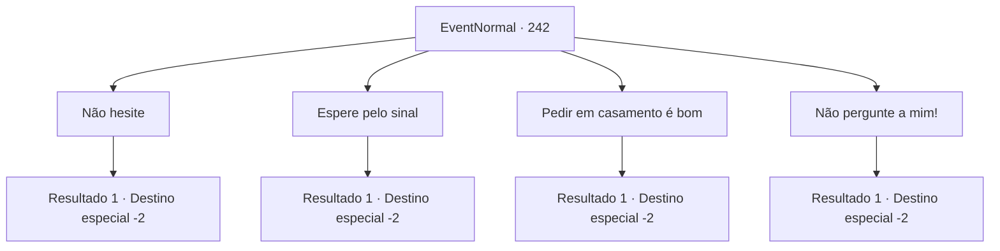

# Eventos normais · 242

[Índice da tabela](index.md) · [Índice geral](../index.md)

ID: `pt:EventNormal:242` · Fonte: `EventNormal4` · Versão: 1.2.47.

Mapeamento estático dos arquivos; a disponibilidade e a execução dependem do estado da run.

## Texto do evento

*Sem texto no arquivo.*

## Dados de entrada

```json
{
  "id": 242,
  "grade": 1,
  "place": "",
  "required": ""
}
```

## Mapa das escolhas



## Escolhas e resultados

### Escolha 1

Não hesite

Requisitos e outros campos da escolha:

```json
{
  "required": ""
}
```

#### Resultado 1.1


 "O quê? Agora?!"

 Ele parece surpreso, mas logo se prepara para ir até o amigo. Você ouve uns sussuros do outro lado, e então um suspiro. Você cai no sono esperando que seu conselho funcione. No dia seguinte, quando você abre os olhos, os dois já se foram.

Continuação registrada: [Destino especial `-2`](../destinos-especiais.md).

```json
{
  "required": "",
  "chance": "1",
  "nextEvent": -2,
  "type": 2,
  "reward": "5_163_1"
}
```

### Escolha 2

Espere pelo sinal

Requisitos e outros campos da escolha:

```json
{
  "required": ""
}
```

#### Resultado 2.1


 "Esperar pelo sinal... e quando será?"

 Você diz a ele que, se a outra pessoa também estiver interessada, definitivamente haverá uma oportunidade. Ele parece estar convencido e aliviado de que, pelo menos, o relacionamento entre os dois não terminará imediatamente. Você se afasta deles em uma encruzilhada, mas ele ainda não a convidou para sair.

Continuação registrada: [Destino especial `-2`](../destinos-especiais.md).

```json
{
  "required": "",
  "chance": "1",
  "nextEvent": -2,
  "type": 2,
  "reward": "5_163_1"
}
```

### Escolha 3

Pedir em casamento é bom

Requisitos e outros campos da escolha:

```json
{
  "required": ""
}
```

#### Resultado 3.1


 "Complicado..."

 Ele parece estar perdido em pensamentos, ouvindo sua resposta. Você o ajuda para ele não ficar ansioso, e ele acena com a cabeça. 

 "Certo. Talvez eu estivesse tentando fazer isso rápido demais... eu deveria me concentrar em entender os sentimentos dela de agora em diante."

 Depois de dizer isso, ele mostra sua gratidão a você. No dia seguinte, você parte em uma encruzilhada. E você percebe que a relação entre os dois está ficando cada vez mais profunda.

Continuação registrada: [Destino especial `-2`](../destinos-especiais.md).

```json
{
  "required": "",
  "chance": "1",
  "nextEvent": -2,
  "type": 2,
  "reward": "5_163_2"
}
```

### Escolha 4

Não pergunte a mim!

Requisitos e outros campos da escolha:

```json
{
  "required": ""
}
```

#### Resultado 4.1

Você responde agressivamente. Ele levanta as duas mãos e pede desculpas por incomodá-lo. Ele lhe dá boa noite e volta para sua tenda. No dia seguinte, quando você abre os olhos, os dois já se foram.

Continuação registrada: [Destino especial `-2`](../destinos-especiais.md).

```json
{
  "required": "",
  "chance": "1",
  "nextEvent": -2,
  "type": 2,
  "reward": "0_3_-1|5_163_1"
}
```

## Referências que chegam a este evento

- [Evento 241 · escolha 2 · resultado 1](0241.md#escolha-2)
