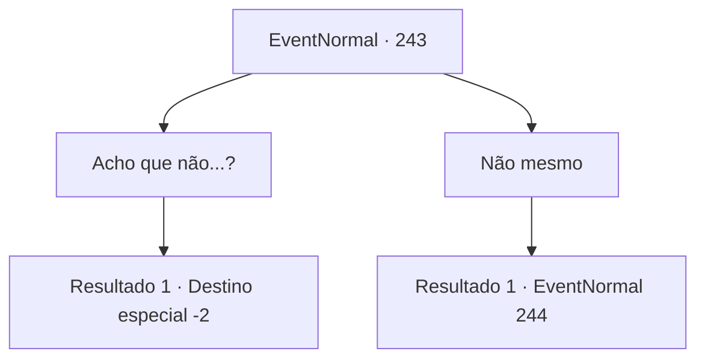

# Eventos normais · 243

[Índice da tabela](index.md) · [Índice geral](../index.md)

ID: `pt:EventNormal:243` · Fonte: `EventNormal4` · Versão: 1.2.47.

Mapeamento estático dos arquivos; a disponibilidade e a execução dependem do estado da run.

## Texto do evento

Ao cruzar uma montanha, você se depara com um casal de aventureiros. Eles se apresentam como Anthony e Nancy. Os dois são amigos próximos de infância e dizem que estão viajando para outra cidade. Graças à natureza gentil de Anthony, vocês três se dão muito bem. Você decide acompanhá-los por um tempo. Naquela noite, quando você se prepara para dormir, Nancy se aproxima de você de repente e fala. 

 "Ei. Você... não está interessado no Anthony, está?"

 Seus olhos parecem instáveis. 

## Dados de entrada

```json
{
  "id": 243,
  "grade": 1,
  "place": "",
  "required": "11_0_1|1_12_11|5_163_0"
}
```

## Mapa das escolhas



## Escolhas e resultados

### Escolha 1

Acho que não...?

Requisitos e outros campos da escolha:

```json
{
  "required": ""
}
```

#### Resultado 1.1

Quando você dá uma resposta vaga, ela grita com o rosto todo vermelho. 

 "Eu gostava dele primeiro! E nós nos conhecemos há, tipo, desde sempre! Então não ouse encostar um dedo nele!"

 Antes que você possa dizer qualquer coisa, ela vai embora, irritada. No dia seguinte, quando você abre os olhos, os dois já se foram.

Continuação registrada: [Destino especial `-2`](../destinos-especiais.md).

```json
{
  "required": "",
  "chance": "1",
  "nextEvent": -2,
  "type": 2,
  "reward": "5_163_1"
}
```

### Escolha 2

Não mesmo

Requisitos e outros campos da escolha:

```json
{
  "required": ""
}
```

#### Resultado 2.1

Quando você responde que não está interessado, ela solta um suspiro de alívio. 

 "Ufa! Isso é um alívio. Na verdade... eu tinha uma quedinha por ele por muito tempo e ainda não consigo convidá-lo para sair."

 Ela então olha para você e cuidadosamente lhe faz uma pergunta: 

 "Você... parece que já teve vários encontros. Você sabe me dizer como posso convidá-lo para sair?"


Continuação registrada: [Evento 244](0244.md) na mesma tabela.

```json
{
  "required": "",
  "chance": "1",
  "nextEvent": 244,
  "type": 2,
  "reward": ""
}
```

## Referências que chegam a este evento

Nenhum `nextEvent` positivo da mesma tabela aponta para este nó. Isso não prova que seja inacessível: sorteio e estado de história podem selecioná-lo.

