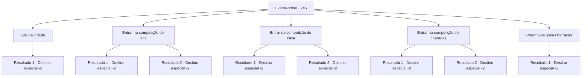

# Eventos normais · 245

[Índice da tabela](index.md) · [Índice geral](../index.md)

ID: `pt:EventNormal:245` · Fonte: `EventNormal4` · Versão: 1.2.47.

Mapeamento estático dos arquivos; a disponibilidade e a execução dependem do estado da run.

## Texto do evento

Você chega a uma cidade onde está acontecendo um festival. Os comerciantes estão anunciando suas mercadorias e você vê jovens dançando juntos. Parece que estão acontecendo algumas competições. Todas elas têm uma taxa de inscrição de cerca de 10 ouros.

## Dados de entrada

```json
{
  "id": 245,
  "grade": 1,
  "place": "",
  "required": "5_168_0"
}
```

## Mapa das escolhas



## Escolhas e resultados

### Escolha 1

Sair da cidade

Requisitos e outros campos da escolha:

```json
{
  "required": ""
}
```

#### Resultado 1.1

Já que comoção e barulho não é o que você gosta, você sai da cidade em silêncio. A música do festival soa, de certa forma, trágica.

Continuação registrada: [Destino especial `-2`](../destinos-especiais.md).

```json
{
  "required": "",
  "chance": "1",
  "nextEvent": -2,
  "type": 2,
  "reward": "5_168_1"
}
```

### Escolha 2

Entrar na competição de luta

Requisitos e outros campos da escolha:

```json
{
  "required": "1_4_10"
}
```

#### Resultado 2.1

Você decide entrar na competição de luta livre. Você compete com outros grandes homens musculosos em termos de força e habilidade, e o adversário da partida final é considerado o campeão do ano anterior. A partir do momento em que você agarra o corpo dele, instintivamente sente que ele é um oponente formidável, mas não tem intenção de perder. 

 "Hyargh!"

 As lutas de poder e habilidade continuam, e você dá o golpe decisivo. Usando o poder bruto do oponente contra ele, você se torna o vencedor. 

 "O vencedor deste ano é {1}!"

 Em meio ao rugido da multidão e com o dinheiro na mão, você sorri.

Continuação registrada: [Destino especial `-2`](../destinos-especiais.md).

```json
{
  "required": "",
  "chance": "1|0_5_1",
  "nextEvent": -2,
  "type": 0,
  "reward": "1_4_-10|0_4_100|0_2_1|5_168_1"
}
```

#### Resultado 2.2

Você decide entrar na competição de luta livre. Você compete com outros grandes homens musculosos em termos de força e habilidade, e o adversário da partida final é considerado o campeão do ano anterior. A partir do momento em que você agarra o corpo dele, instintivamente sente que ele é um oponente formidável, mas não tem intenção de perder. 

 "Hyargh!"

 As lutas de poder e habilidade continuam, e você dá o golpe decisivo, mas a força bruta do oponente não lhe dá nenhuma chance de retaliar. 

 "Hahaha! Vitória fácil!"

 Você franze a testa com a dor na cintura e foge do campeão.

Continuação registrada: [Destino especial `-2`](../destinos-especiais.md).

```json
{
  "required": "",
  "chance": "13",
  "nextEvent": -2,
  "type": 1,
  "reward": "0_4_-10|5_168_1"
}
```

### Escolha 3

Entrar na competição de caça

Requisitos e outros campos da escolha:

```json
{
  "required": "1_4_10"
}
```

#### Resultado 3.1

Você decide entrar na competição de caça. Você entra na floresta perto da cidade, caçando animais raros, colocando armadilhas e atirando flechas. Finalmente, o jogo é ganho quando você pega um veado com pele branca semelhante a uma pérola. 

 "O vencedor, {1}!"

 O velho caçador declara enquanto olha para o animal de cada um, segurando seu braço. Um arco de mithril é dado a você como prêmio.

Continuação registrada: [Destino especial `-2`](../destinos-especiais.md).

```json
{
  "required": "",
  "chance": "1|0_6_1",
  "nextEvent": -2,
  "type": 0,
  "reward": "1_4_-10|3_79_1|0_2_1|5_168_1"
}
```

#### Resultado 3.2

Você decide entrar na competição de caça. Você entra na floresta perto da cidade, caçando animais raros, colocando armadilhas e atirando flechas. Mas tudo que você consegue pegar é um coelhinho. O velho caçador, o juiz da competição, dá uma olhada no seu coelho e balança a cabeça. 

 "Muito comum."

 Você só pode invejar o caçador com um cervo de pele branca e perolada.

Continuação registrada: [Destino especial `-2`](../destinos-especiais.md).

```json
{
  "required": "",
  "chance": "13",
  "nextEvent": -2,
  "type": 1,
  "reward": "0_4_-10|5_168_1"
}
```

### Escolha 4

Entrar na competição de charadas

Requisitos e outros campos da escolha:

```json
{
  "required": "1_4_10"
}
```

#### Resultado 4.1

Você decide entrar na competição de enigmas. Todas as esferas da vida da cidade, desde estudiosos famosos a donas de casa e crianças pequenas, participam da competição. Depois de todos os tipos de enigmas diferentes, como múltiplas escolhas, vinte perguntas e O/Xs, você é o único que resta. O MC da competição lê a última pergunta com uma voz muito séria. 

 "O que a abelha diz quando volta para sua colmeia?"

 Você escreve 'Querida, cheguei' com uma cara igualmente séria. Está correto. Você toca o sino dourado, como símbolo de vitória na competição. 

 "Nós o aplaudimos por sua inteligência!"

 O MC lhe entrega uma caixa de madeira, e dentro você encontra um frasco cheio de líquido branco.

Continuação registrada: [Destino especial `-2`](../destinos-especiais.md).

```json
{
  "required": "",
  "chance": "1|0_7_1",
  "nextEvent": -2,
  "type": 0,
  "reward": "1_4_-10|5_168_1|3_100_1"
}
```

#### Resultado 4.2

Você decide entrar na competição de enigmas. Todas as esferas da vida da cidade, desde estudiosos famosos a donas de casa e crianças pequenas, participam da competição. Depois de todos os tipos de enigmas diferentes, como múltiplas escolhas, vinte perguntas e O/Xs, você é o único que resta. O MC da competição lê a última pergunta com uma voz muito séria. 

 "O que a abelha diz quando volta para sua colmeia?"

 Você considera cuidadosamente por um longo tempo, mas não consegue descobrir a resposta antes que o tempo se esgote. Infelizmente, você não consegue acertar a pergunta e perde a competição.

Continuação registrada: [Destino especial `-2`](../destinos-especiais.md).

```json
{
  "required": "",
  "chance": "13",
  "nextEvent": -2,
  "type": 1,
  "reward": "0_4_-10|5_168_1"
}
```

### Escolha 5

Perambular pelas barracas

Requisitos e outros campos da escolha:

```json
{
  "required": "1_4_50"
}
```

#### Resultado 5.1

Para se livrar de todo o estresse e fadiga de viajar, você se concentra em ficar empolgado e alimentado. A torrada te refresca fisicamente, porém você sente que sua bolsa ficou mais leve.

Continuação registrada: [Destino especial `-2`](../destinos-especiais.md).

```json
{
  "required": "",
  "chance": "1",
  "nextEvent": -2,
  "type": 2,
  "reward": "0_0_1|0_1_1|0_4_-50|5_168_1"
}
```

## Referências que chegam a este evento

Nenhum `nextEvent` positivo da mesma tabela aponta para este nó. Isso não prova que seja inacessível: sorteio e estado de história podem selecioná-lo.

