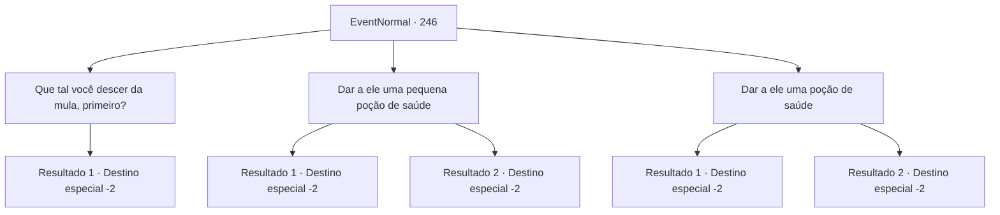

# Eventos normais · 246

[Índice da tabela](index.md) · [Índice geral](../index.md)

ID: `pt:EventNormal:246` · Fonte: `EventNormal4` · Versão: 1.2.47.

Mapeamento estático dos arquivos; a disponibilidade e a execução dependem do estado da run.

## Texto do evento

Você encontra um cavaleiro montado em um burro trôpego. 

 "Oh! Um viajante! Eu sou o valente cavaleiro Ron Quixote! Você tem um momento para ouvir minha história?"

 Ron Quixote continua sem ouvir sua resposta. 

 "Como você pode ver, meu amado cavalo não está se sentindo muito bem! Você tem algum tipo de medicamento que possa ajudar com isso?"

 Ron Quixote tem pena do burro, acariciando sua cabeça. Mas parece que ele não tem intenção de descer dele.

## Dados de entrada

```json
{
  "id": 246,
  "grade": 1,
  "place": "",
  "required": "5_166_0"
}
```

## Mapa das escolhas



## Escolhas e resultados

### Escolha 1

Que tal você descer da mula, primeiro?

Requisitos e outros campos da escolha:

```json
{
  "required": ""
}
```

#### Resultado 1.1

Quando você pede para ele descer do burro, Ron Quixote grita com raiva. 

 "Como você espera que um cavaleiro como eu toque o chão sem a ajuda de seus servos leais!"

 Ron Quixote soca seu peitoral de aço, explicando as 122 restrições que um cavaleiro deve seguir. Depois de um longo discurso, ele murmura algo sem sentido e sai. Você ouve o lamento do burro ao longe.

Continuação registrada: [Destino especial `-2`](../destinos-especiais.md).

```json
{
  "required": "",
  "chance": "1",
  "nextEvent": -2,
  "type": 2,
  "reward": "5_166_1"
}
```

### Escolha 2

Dar a ele uma pequena poção de saúde

Requisitos e outros campos da escolha:

```json
{
  "required": "8_190_1"
}
```

#### Resultado 2.1

Ron Quixote agradece, tomando a poção que você deu a ele. Ele dá metade ao jumento e o resto a si mesmo. 

 "Muito obrigado! Você é um homem que conhece o cavalheirismo!"

 Ron Quixote vasculha seus bolsos, pegando um pedaço de minério de cobre. 

 "Esta é uma recompensa que te dou em meu nome!"

 Depois de lhe entregar o minério de cobre, como se estivesse entregando ouro, ele passa por você montado no burro trôpego. Você ouve o lamento do burro ao longe.

Continuação registrada: [Destino especial `-2`](../destinos-especiais.md).

```json
{
  "required": "8_190_1",
  "chance": "1",
  "nextEvent": -2,
  "type": 2,
  "reward": "3_126_1|0_3_1|0_2_1|4_190_1|5_166_1"
}
```

#### Resultado 2.2

Você acha que deveria entregar uma poção a ele, mas você não tem nenhuma em sua mochila. Ron Quixote resmunga, olhando para você vasculhando sua mochila. 

 "Uhh... tudo bem, se você não quiser."

 Ele sai com o burro, e você ouve o lamento do burro ao longe. 

Continuação registrada: [Destino especial `-2`](../destinos-especiais.md).

```json
{
  "required": "10_190_1",
  "chance": "1",
  "nextEvent": -2,
  "type": 2,
  "reward": "5_166_1"
}
```

### Escolha 3

Dar a ele uma poção de saúde

Requisitos e outros campos da escolha:

```json
{
  "required": "8_36_1"
}
```

#### Resultado 3.1

Ron Quixote agradece, tomando a poção que você deu a ele. Ele dá metade ao jumento e o resto a si mesmo. 

 "Muito obrigado! Você é um homem que conhece o cavalheirismo!"

 Ron Quixote vasculha seus bolsos, tirando um pargo vermelho. 

 "Esta é uma recompensa que lhe dou em meu nome!"

 Depois de lhe entregar o pargo, como se estivesse entregando ouro, ele passa por você no burro cambaleante. Você ouve o lamento do burro ao longe.

Continuação registrada: [Destino especial `-2`](../destinos-especiais.md).

```json
{
  "required": "8_36_1",
  "chance": "1",
  "nextEvent": -2,
  "type": 2,
  "reward": "3_125_1|0_3_2|0_2_1|4_36_1|5_166_1"
}
```

#### Resultado 3.2

Você acha que deveria entregar uma poção a ele, mas você não tem nenhuma em sua mochila. Ron Quixote resmunga, olhando para você vasculhando sua mochila. 

 "Urgh... tudo bem, se você não quiser."

 Ele sai com o burro, e você ouve o lamento do burro ao longe. 

Continuação registrada: [Destino especial `-2`](../destinos-especiais.md).

```json
{
  "required": "10_36_1",
  "chance": "1",
  "nextEvent": -2,
  "type": 2,
  "reward": "5_166_1"
}
```

## Referências que chegam a este evento

Nenhum `nextEvent` positivo da mesma tabela aponta para este nó. Isso não prova que seja inacessível: sorteio e estado de história podem selecioná-lo.

