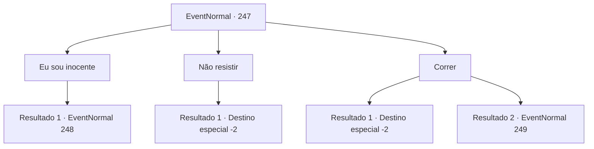

# Eventos normais · 247

[Índice da tabela](index.md) · [Índice geral](../index.md)

ID: `pt:EventNormal:247` · Fonte: `EventNormal4` · Versão: 1.2.47.

Mapeamento estático dos arquivos; a disponibilidade e a execução dependem do estado da run.

## Texto do evento

Você chega à cidade-fortaleza 'Muro de Ferro', construída na beira de um penhasco. Enquanto você procura uma pousada para descansar, por algum motivo os guardas prendem você. 

 "Aventureiro {1}! Você está preso pelos 17 crimes que cometeu na cidade!"

 Os guardas se aproximam de você, murmurando coisas que você não entende.

## Dados de entrada

```json
{
  "id": 247,
  "grade": 1,
  "place": "",
  "required": "1_2_60|5_167_0"
}
```

## Mapa das escolhas



## Escolhas e resultados

### Escolha 1

Eu sou inocente

Requisitos e outros campos da escolha:

```json
{
  "required": ""
}
```

#### Resultado 1.1

Você afirma que não tem culpa. Um dos guardas começa a gritar com você. 

 "Há mais de 10 testemunhas confirmando sua atividade criminosa! Temos até um retrato falado. Você quer enganar quem?"

 Quando você olha para o retrato que ele tirou, realmente há um rosto que se parece com o seu.

Continuação registrada: [Evento 248](0248.md) na mesma tabela.

```json
{
  "required": "",
  "chance": "1",
  "nextEvent": 248,
  "type": 2,
  "reward": "5_167_1"
}
```

### Escolha 2

Não resistir

Requisitos e outros campos da escolha:

```json
{
  "required": ""
}
```

#### Resultado 2.1

Pensando que seria idiotice lutar contra um grupo inteiro de guardas, você decide ser preso. Você pede uma chance de provar sua inocência na cela da prisão, sem sucesso. No dia do julgamento, você é multado em 100 ouros por assalto à mão armada, agressão e tentativa de incêndio criminoso, e depois expulso da cidade. Você alega inocência, mas as inúmeras testemunhas de seu rosto o silenciam.

Continuação registrada: [Destino especial `-2`](../destinos-especiais.md).

```json
{
  "required": "",
  "chance": "1",
  "nextEvent": -2,
  "type": 2,
  "reward": "0_4_-100|5_167_1"
}
```

### Escolha 3

Correr

Requisitos e outros campos da escolha:

```json
{
  "required": ""
}
```

#### Resultado 3.1

Você não tem ideia do que diabos está acontecendo, mas você decide fugir. Vários guardas perseguem você, mas você é rápido demais para eles. Só depois de correr por um tempo e perceber que não há mais perseguidores, você respira aliviado.

Continuação registrada: [Destino especial `-2`](../destinos-especiais.md).

```json
{
  "required": "",
  "chance": "1|0_6_1",
  "nextEvent": -2,
  "type": 0,
  "reward": "5_167_1|0_2_1"
}
```

#### Resultado 3.2

Você não tem ideia do que diabos está acontecendo, mas você decide fugir. Mas os guardas são mais rápidos que você, e você prepara sua arma, estalando a boca.

Continuação registrada: [Evento 249](0249.md) na mesma tabela.

```json
{
  "required": "",
  "chance": "15",
  "nextEvent": 249,
  "type": 1,
  "reward": "6_0_21|5_167_1",
  "place": 4
}
```

## Referências que chegam a este evento

Nenhum `nextEvent` positivo da mesma tabela aponta para este nó. Isso não prova que seja inacessível: sorteio e estado de história podem selecioná-lo.

