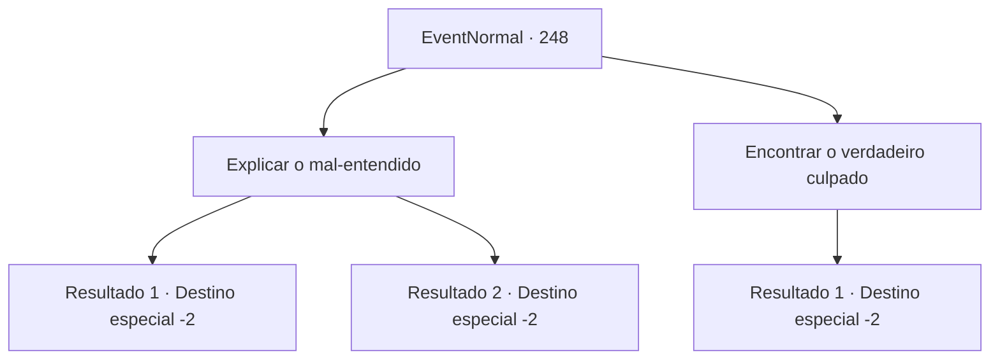

# Eventos normais · 248

[Índice da tabela](index.md) · [Índice geral](../index.md)

ID: `pt:EventNormal:248` · Fonte: `EventNormal4` · Versão: 1.2.47.

Mapeamento estático dos arquivos; a disponibilidade e a execução dependem do estado da run.

## Texto do evento

*Sem texto no arquivo.*

## Dados de entrada

```json
{
  "id": 248,
  "grade": 1,
  "place": "",
  "required": ""
}
```

## Mapa das escolhas



## Escolhas e resultados

### Escolha 1

Explicar o mal-entendido

Requisitos e outros campos da escolha:

```json
{
  "required": ""
}
```

#### Resultado 1.1

Você prova sua inocência com um discurso polido e uma lógica impecável. Os guardas e até os civis que observam a cena começam a murmurar. 

 "Isto não é... hum... Entendi... Agora sabemos sobre sua inocência. Pedimos desculpas."

 Você deixa a cidade confiante com as desculpas dos guardas. 

Continuação registrada: [Destino especial `-2`](../destinos-especiais.md).

```json
{
  "required": "",
  "chance": "1|0_7_1",
  "nextEvent": -2,
  "type": 0,
  "reward": "0_2_1"
}
```

#### Resultado 1.2

Você tenta provar sua inocência, mas os guardas não ouvem. Infelizmente, você está preso em uma cela de prisão e alguns dias depois, no dia do julgamento, você é multado em 100 ouros por assalto à mão armada, agressão e tentativa de incêndio criminoso, depois expulso da cidade. Você implora por sua inocência, mas o juiz não ouve.

Continuação registrada: [Destino especial `-2`](../destinos-especiais.md).

```json
{
  "required": "",
  "chance": "17",
  "nextEvent": -2,
  "type": 1,
  "reward": "0_4_-100|0_2_1"
}
```

### Escolha 2

Encontrar o verdadeiro culpado

Requisitos e outros campos da escolha:

```json
{
  "required": ""
}
```

#### Resultado 2.1

Você diz a eles que encontrará o impostor para provar sua inocência. Os guardas acham que você é o suspeito, mas sua confiança os leva a lhe dar uma chance. Você começa uma vigilância com dois outros guardas.

  Depois de um tempo, você vê alguém agindo igual a você, causando um tumulto no mercado. 

 "Idiota! Você sabe quem eu sou?! Eu sou o famoso aventureiro {1}!"

 Incapaz de ver a cena se desenrolar, você pula na frente dele, pegando o impostor em flagrante. Ele tenta fugir, com o rosto todo pálido, mas logo é pego pelos guardas, e agora implora por misericórdia. 

 "D-desculpa! {1}! Eu não sabia que você estava por aqui! Por favor, me perdoe!"

 Segundo ele, sua fama lhe permitiu viver uma vida confortável ao agir como você. Porém os guardas o amarram com uma corda, pedem desculpas a você pelo mal-entendido e lhe entregam algumas moedas de ouro por capturar o culpado.

Continuação registrada: [Destino especial `-2`](../destinos-especiais.md).

```json
{
  "required": "",
  "chance": "1",
  "nextEvent": -2,
  "type": 2,
  "reward": "0_4_50|0_2_1"
}
```

## Referências que chegam a este evento

- [Evento 247 · escolha 1 · resultado 1](0247.md#escolha-1)
