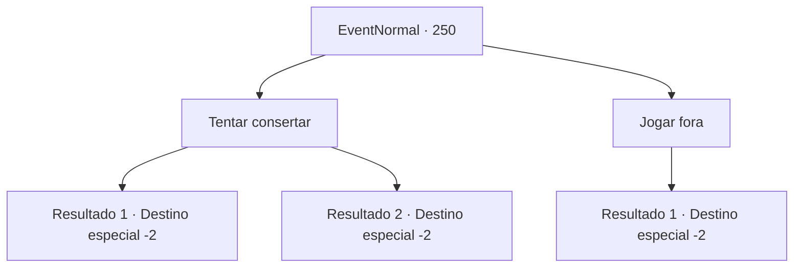

# Eventos normais · 250

[Índice da tabela](index.md) · [Índice geral](../index.md)

ID: `pt:EventNormal:250` · Fonte: `EventNormal4` · Versão: 1.2.47.

Mapeamento estático dos arquivos; a disponibilidade e a execução dependem do estado da run.

## Texto do evento

Você percebe que o meio do cajado de madeira tem uma rachadura. Talvez o ingrediente madeira fosse de má qualidade, ou porque o bastão era usado bastante como bengala. Você está perplexo sobre o que fazer com o cajado de madeira rachado.

## Dados de entrada

```json
{
  "id": 250,
  "grade": 1,
  "place": "",
  "required": "8_8_1"
}
```

## Mapa das escolhas



## Escolhas e resultados

### Escolha 1

Tentar consertar

Requisitos e outros campos da escolha:

```json
{
  "required": ""
}
```

#### Resultado 1.1

Você tenta consertar o cajado de madeira. Você cola a rachadura com seiva pegajosa e aperta com um pano. Depois de alguns giros, o cajado está bom de novo.

Continuação registrada: [Destino especial `-2`](../destinos-especiais.md).

```json
{
  "required": "",
  "chance": "1|0_7_1",
  "nextEvent": -2,
  "type": 0,
  "reward": ""
}
```

#### Resultado 1.2

Você tenta consertar o cajado de madeira, mas ele acaba quebrando. Porém, ele se torna um bom combustível para o fogo naquela noite.

Continuação registrada: [Destino especial `-2`](../destinos-especiais.md).

```json
{
  "required": "",
  "chance": "10",
  "nextEvent": -2,
  "type": 1,
  "reward": "4_8_1"
}
```

### Escolha 2

Jogar fora

Requisitos e outros campos da escolha:

```json
{
  "required": ""
}
```

#### Resultado 2.1

Você decide jogar fora o cajado de madeira. Não é apenas madeira esculpida, e como é um item mágico, consertá-lo de forma imperfeita não fará com que funcione corretamente.

Continuação registrada: [Destino especial `-2`](../destinos-especiais.md).

```json
{
  "required": "",
  "chance": "1",
  "nextEvent": -2,
  "type": 2,
  "reward": "4_8_1"
}
```

## Referências que chegam a este evento

Nenhum `nextEvent` positivo da mesma tabela aponta para este nó. Isso não prova que seja inacessível: sorteio e estado de história podem selecioná-lo.

