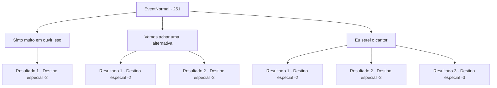

# Eventos normais · 251

[Índice da tabela](index.md) · [Índice geral](../index.md)

ID: `pt:EventNormal:251` · Fonte: `EventNormal4` · Versão: 1.2.47.

Mapeamento estático dos arquivos; a disponibilidade e a execução dependem do estado da run.

## Texto do evento

Você está rondando pelo lugar, tentando assistir a performance do carnaval itinerante. Então, você se depara com um senhor, que está perdido em um pensamento preocupante, com uma expressão séria no rosto. Você se aproxima do cavalheiro, perguntando qual é o problema. Ele se apresenta como o dono do carnaval itinerante e conta sua história. 

 "Na verdade, nosso cantor convidado de hoje está com febre e não pode se apresentar. O que eu deveria fazer agora..."

 Ele também explica que alguns convidados vêm à apresentação apenas para ver aquele cantor, então você não poderá substituir o cantor por ninguém.

## Dados de entrada

```json
{
  "id": 251,
  "grade": 1,
  "place": "",
  "required": "5_167_0"
}
```

## Mapa das escolhas



## Escolhas e resultados

### Escolha 1

Sinto muito em ouvir isso

Requisitos e outros campos da escolha:

```json
{
  "required": ""
}
```

#### Resultado 1.1

Você estala a língua em solidariedade, mas não há nada que possa fazer para ajudar. O dono agradece o carinho, mas volta para o festival com cara de preocupado. Depois de um tempo, a cantora sobe ao palco e explica sua condição, mas o público está furioso, incapaz de assistir à apresentação que esperava, exigindo reembolsos. Você sai do carnaval em silêncio, antes que a multidão fique ainda mais selvagem.

Continuação registrada: [Destino especial `-2`](../destinos-especiais.md).

```json
{
  "required": "",
  "chance": "1",
  "nextEvent": -2,
  "type": 2,
  "reward": "5_167_1"
}
```

### Escolha 2

Vamos achar uma alternativa

Requisitos e outros campos da escolha:

```json
{
  "required": ""
}
```

#### Resultado 2.1

Depois de procurar na cidade por um tempo, você encontra outra cantoa aposentada em uma parte da cidade. A princípio ela recusa sua proposta, mas acaba aceitando depois de ouvir a triste história do festival. Durante a apresentação, ela faz uma performance maravilhosa, apesar de não ter se apresentado há vários anos e o público explode em aplausos, tocado por suas canções. O proprietário agradece e recebe uma varinha de vidro como sinal de gratidão.

Continuação registrada: [Destino especial `-2`](../destinos-especiais.md).

```json
{
  "required": "",
  "chance": "1|0_7_1",
  "nextEvent": -2,
  "type": 0,
  "reward": "3_89_1|0_2_1|5_167_2"
}
```

#### Resultado 2.2

Depois de ouvir a triste história do festival, você procura uma pessoa para substituir a cantora, mas não consegue encontrar ninguém que se encaixe até a hora da apresentação. Você consegue ouvir a multidão furiosa ainda do lado de fora. Então você decide ir para outro lugar.

Continuação registrada: [Destino especial `-2`](../destinos-especiais.md).

```json
{
  "required": "",
  "chance": "13",
  "nextEvent": -2,
  "type": 1,
  "reward": "5_167_1"
}
```

### Escolha 3

Eu serei o cantor

Requisitos e outros campos da escolha:

```json
{
  "required": ""
}
```

#### Resultado 3.1

Você decide se apresentar, em vez da cantora. O dono parece preocupado, balançando a cabeça, mas acaba concordando. 

 "...Parece que não temos outra escolha. Então, boa sorte."

 Você parece um pouco estranho em traje de performance, o qual você não é mesmo acostumado a usar, mas você acaba ficando bem no final. Você sobe ao palco, a reação do público é uma mistura de expectativa com confusão. Tentando ao máximo ignorar os olhares, você começa a primeira música.
 *Aplausos e mais aplausos*
 A performance foi um sucesso! A multidão, embora cética no início, acaba elogiando sua voz com aplausos estrondosos. Após a última música, o público festeja e grita seu nome. O proprietário agradece o desempenho bem-sucedido, presenteando-o com uma varinha de vidro e moedas de ouro como forma de agradecimento.

Continuação registrada: [Destino especial `-2`](../destinos-especiais.md).

```json
{
  "required": "",
  "chance": "1|0_12_1",
  "nextEvent": -2,
  "type": 0,
  "reward": "3_89_1|0_4_50|0_2_1|5_167_2"
}
```

#### Resultado 3.2

Você decide se apresentar, no lugar da cantora. O dono parece preocupado, balançando a cabeça, mas acaba concordando. 

 "...Parece que não temos outra escolha. Então, boa sorte."

 Mas suas habilidades de canto não combinam com sua confiança e a multidão fica brava com o som estridente antes mesmo da primeira música terminar. Você é atingido aqui e ali pelo lixo jogado, e acaba fugindo com o traje completamente esfarrapado.

Continuação registrada: [Destino especial `-2`](../destinos-especiais.md).

```json
{
  "required": "1_0_2",
  "chance": "15",
  "nextEvent": -2,
  "type": 1,
  "reward": "0_0_-1|5_167_1"
}
```

#### Resultado 3.3

Você decide se apresentar no lugar da cantora. O dono parece preocupado, balançando a cabeça, mas acaba concordando. 

 "...Parece que não temos outra escolha. Então, boa sorte."

 Mas suas habilidades de canto não combinam com sua confiança e a multidão fica brava com o som estridente antes mesmo da primeira música terminar. Você é atingido por lixos jogados contra você e acaba perdendo a consciência.

Continuação registrada: [Destino especial `-3`](../destinos-especiais.md).

```json
{
  "required": "2_0_2",
  "chance": "15",
  "nextEvent": -3,
  "type": 1,
  "reward": "0_0_-1|5_167_1"
}
```

## Referências que chegam a este evento

Nenhum `nextEvent` positivo da mesma tabela aponta para este nó. Isso não prova que seja inacessível: sorteio e estado de história podem selecioná-lo.

