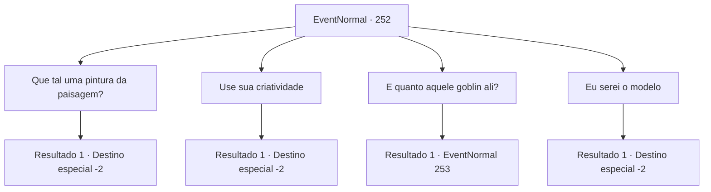

# Eventos normais · 252

[Índice da tabela](index.md) · [Índice geral](../index.md)

ID: `pt:EventNormal:252` · Fonte: `EventNormal4` · Versão: 1.2.47.

Mapeamento estático dos arquivos; a disponibilidade e a execução dependem do estado da run.

## Texto do evento

Você conhece um artista ambulante. Ele diz que vagueia de um lugar para outro, em busca da inspiração perfeita para uma obra-prima. 

 "O que devo pintar?"

 O artista pergunta a você com uma cara profundamente preocupada, olhando para seu caderno em branco. |drawing_emptyCanvas|

## Dados de entrada

```json
{
  "id": 252,
  "grade": 1,
  "place": "",
  "required": "5_179_0"
}
```

## Mapa das escolhas



## Escolhas e resultados

### Escolha 1

Que tal uma pintura da paisagem?

Requisitos e outros campos da escolha:

```json
{
  "required": ""
}
```

#### Resultado 1.1

Você aponta para uma bela pintura, visível ao longe. 

 "Uma pintura de paisagem... definitivamente não é ruim, mas não é um pouco simples demais?"

 Embora ele comece a pintar a paisagem como você disse, o olhar duvidoso em seu rosto está lhe dizendo que ele não está satisfeito. Por fim, depois de olhar para a pintura que desenhou, ele a destrói e começa a gritar, arrancando seu cabelo. 

 "Não! Não é isso-!!"

 Você foge dele, sentindo uma certa quantidade de insanidade.

Continuação registrada: [Destino especial `-2`](../destinos-especiais.md).

```json
{
  "required": "",
  "chance": "1",
  "nextEvent": -2,
  "type": 2,
  "reward": "5_179_1"
}
```

### Escolha 2

Use sua criatividade

Requisitos e outros campos da escolha:

```json
{
  "required": ""
}
```

#### Resultado 2.1

Você toca em seus ouvidos, sinalizando para ele usar sua criatividade. 

 "Uma pintura imaginativa... hm. Talvez eu possa pensar em algo, talvez não..."

 Ele envolve a cabeça com as mãos, tentando espremer uma ideia para sua pintura. Mas ele logo quebra a tela ao meio, e então grita enquanto arranca seu cabelo. 

 "Não! Não é isso-!!"

 Você foge dele, sentindo uma certa quantidade de insanidade.

Continuação registrada: [Destino especial `-2`](../destinos-especiais.md).

```json
{
  "required": "",
  "chance": "1",
  "nextEvent": -2,
  "type": 2,
  "reward": "5_179_1"
}
```

### Escolha 3

E quanto aquele goblin ali?

Requisitos e outros campos da escolha:

```json
{
  "required": ""
}
```

#### Resultado 3.1

Você aponta para o goblin, se aproximando à distância. 

 "Um goblin, hein... não sou contra a ideia de desenhar monstros... mas... isso parece um pouco perigoso...!!"

 Depois de ficar perdido em pensamentos por um tempo, ele vê o goblin correndo em sua direção com um porrete na mão e grita de espanto. Sem palavras, você prepara sua arma e corre em direção ao goblin para atacá-lo

Continuação registrada: [Evento 253](0253.md) na mesma tabela.

```json
{
  "required": "",
  "chance": "1",
  "nextEvent": 253,
  "type": 2,
  "reward": "6_3_1|5_179_1",
  "place": 0
}
```

### Escolha 4

Eu serei o modelo

Requisitos e outros campos da escolha:

```json
{
  "required": "1_12_13"
}
```

#### Resultado 4.1

Você sugere a ele que ele use você como modelo. Ele te examina da cabeça aos pés e concorda. 

 "Hmm... Usando você como modelo? Boa ideia! Eu acho que dá pra criar algo muito bom."

 Obedecendo às instruções do artista, você fica parado por horas em uma determinada pose. E toda vez que você contrai até mesmo as menores partes do seu corpo, você ouve a repreensão do artista. Assim que o sol se põe, a pintura finalmente fica pronta, ele sorri feliz. 

 "Obrigado! Essa pintura vai me deixar famoso!"

 Ele paga pelo seu tempo e vai embora.

Continuação registrada: [Destino especial `-2`](../destinos-especiais.md).

```json
{
  "required": "",
  "chance": "1",
  "nextEvent": -2,
  "type": 2,
  "reward": "0_4_30|0_2_1|5_179_1"
}
```

## Referências que chegam a este evento

Nenhum `nextEvent` positivo da mesma tabela aponta para este nó. Isso não prova que seja inacessível: sorteio e estado de história podem selecioná-lo.

