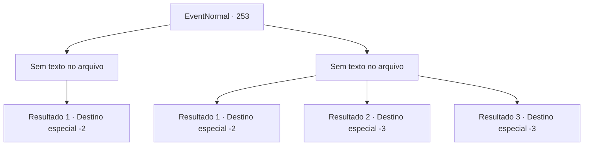

# Eventos normais · 253

[Índice da tabela](index.md) · [Índice geral](../index.md)

ID: `pt:EventNormal:253` · Fonte: `EventNormal4` · Versão: 1.2.47.

Mapeamento estático dos arquivos; a disponibilidade e a execução dependem do estado da run.

## Texto do evento

*Sem texto no arquivo.*

## Dados de entrada

```json
{
  "id": 253,
  "grade": 1,
  "place": "",
  "required": ""
}
```

## Mapa das escolhas



## Escolhas e resultados

### Escolha 1

*Sem texto no arquivo; o papel dessa opção depende da interface do jogo.*

Requisitos e outros campos da escolha:

```json
{
  "required": ""
}
```

#### Resultado 1.1

Você derrota o goblin e traz seu corpo para o artista. Mas ele balança a cabeça em desgosto. 

 "Eca, que nojo! Como vou pintar algo assim? Por favor, tire isso da minha vista!"

 Como o artista responde como se fosse vomitar, você libera o goblin de volta à sua liberdade. Ele foge às pressas, e o artista, agora calmo, vai embora em busca de outra inspiração.

Continuação registrada: [Destino especial `-2`](../destinos-especiais.md).

```json
{
  "required": "",
  "chance": "1",
  "nextEvent": -2,
  "type": 2,
  "reward": ""
}
```

### Escolha 2

*Sem texto no arquivo; o papel dessa opção depende da interface do jogo.*

Requisitos e outros campos da escolha:

```json
{
  "required": ""
}
```

#### Resultado 2.1

Você sente que não será capaz de derrotar o goblin e fugir. O artista, também fugindo atrás de você, se despede depois de perceber que o goblin não o está mais perseguindo.

Continuação registrada: [Destino especial `-2`](../destinos-especiais.md).

```json
{
  "required": "1_0_2|1_1_2",
  "chance": "1",
  "nextEvent": -2,
  "type": 2,
  "reward": "0_0_-1|0_1_-1"
}
```

#### Resultado 2.2

Enquanto luta contra o goblin, você perde o equilíbrio e cai. Aproveitando a oportunidade, o goblin o apunhala em seu ponto fraco. A última coisa que você vê em sua visão embaçada é o artista vagante, fugindo com um rosto pálido.

Continuação registrada: [Destino especial `-3`](../destinos-especiais.md).

```json
{
  "required": "2_0_2",
  "chance": "1",
  "nextEvent": -3,
  "type": 2,
  "reward": "0_0_-1|0_1_-1"
}
```

#### Resultado 2.3

Enquanto luta contra o goblin, você perde o equilíbrio e cai. Aproveitando a oportunidade, o goblin o apunhala em um ponto fraco. A última coisa que você vê em sua visão embaçada é o artista errante, fugindo com um rosto pálido.

Continuação registrada: [Destino especial `-3`](../destinos-especiais.md).

```json
{
  "required": "2_1_2",
  "chance": "1",
  "nextEvent": -3,
  "type": 2,
  "reward": "0_0_-1|0_1_-1"
}
```

## Referências que chegam a este evento

- [Evento 252 · escolha 3 · resultado 1](0252.md#escolha-3)
