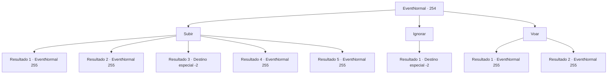

# Eventos normais · 254

[Índice da tabela](index.md) · [Índice geral](../index.md)

ID: `pt:EventNormal:254` · Fonte: `EventNormal4` · Versão: 1.2.47.

Mapeamento estático dos arquivos; a disponibilidade e a execução dependem do estado da run.

## Texto do evento

Você encontra um ninho de pássaro, feito no topo de uma árvore enorme. Julgando pelo tamanho do ninho, provavelmente pertence a um pássaro gigante.

## Dados de entrada

```json
{
  "id": 254,
  "grade": 1,
  "place": "",
  "required": "5_180_0"
}
```

## Mapa das escolhas



## Escolhas e resultados

### Escolha 1

Subir

Requisitos e outros campos da escolha:

```json
{
  "required": ""
}
```

#### Resultado 1.1

Você sobe cuidadosamente na árvore, e encontra ovos enormes, grandes demais para serem considerados ovos de um ser vivo. Você os inspeciona de perto, mas não consegue descobrir de quem são.

Continuação registrada: [Evento 255](0255.md) na mesma tabela.

```json
{
  "required": "2_7_13|21_32_1",
  "chance": "1|0_5_1",
  "nextEvent": 255,
  "type": 0,
  "reward": "5_180_1"
}
```

#### Resultado 1.2

Você sobe cuidadosamente na árvore, e encontra ovos enormes, grandes demais para serem considerados ovos de um ser vivo. Você os reconhece imediatamente como ovos de grifo.

Continuação registrada: [Evento 255](0255.md) na mesma tabela.

```json
{
  "required": "1_7_13|21_32_1",
  "chance": "1|0_5_1",
  "nextEvent": 255,
  "type": 0,
  "reward": "5_180_2"
}
```

#### Resultado 1.3

Você tenta subir na árvore, mas acaba caindo. Depois de cair no chão, você desiste de subir na árvore.

Continuação registrada: [Destino especial `-2`](../destinos-especiais.md).

```json
{
  "required": "",
  "chance": "8",
  "nextEvent": -2,
  "type": 1,
  "reward": "5_180_1"
}
```

#### Resultado 1.4

Você sobe cuidadosamente na árvore, e encontra ovos enormes, grandes demais para serem considerados ovos de um ser vivo. Você os inspeciona de perto, mas não consegue descobrir de quem são.

Continuação registrada: [Evento 255](0255.md) na mesma tabela.

```json
{
  "required": "2_7_13|20_32_1",
  "chance": "1",
  "nextEvent": 255,
  "type": 2,
  "reward": "5_180_1"
}
```

#### Resultado 1.5

Você sobe cuidadosamente na árvore, e encontra ovos enormes, grandes demais para serem considerados ovos de um ser vivo. Você os reconhece imediatamente como ovos de grifo.

Continuação registrada: [Evento 255](0255.md) na mesma tabela.

```json
{
  "required": "1_7_13|20_32_1",
  "chance": "1",
  "nextEvent": 255,
  "type": 2,
  "reward": ""
}
```

### Escolha 2

Ignorar

Requisitos e outros campos da escolha:

```json
{
  "required": ""
}
```

#### Resultado 2.1

Você decide ignorar o enorme ninho.

Continuação registrada: [Destino especial `-2`](../destinos-especiais.md).

```json
{
  "required": "",
  "chance": "1",
  "nextEvent": -2,
  "type": 2,
  "reward": "5_180_1"
}
```

### Escolha 3

Voar

Requisitos e outros campos da escolha:

```json
{
  "required": "-1|20_10_1|20_0_2"
}
```

#### Resultado 3.1

Você se eleva e sobe na árvore, e encontra ovos enormes, grandes demais para serem considerados ovos de um ser vivo. Você os inspeciona de perto, mas não consegue descobrir de quem são.

Continuação registrada: [Evento 255](0255.md) na mesma tabela.

```json
{
  "required": "2_7_13",
  "chance": "1",
  "nextEvent": 255,
  "type": 2,
  "reward": "5_180_1"
}
```

#### Resultado 3.2

Você se eleva e sobe na árvore, e encontra ovos enormes, grandes demais para serem considerados ovos de um ser vivo.  Você os reconhece imediatamente como ovos de grifo.

Continuação registrada: [Evento 255](0255.md) na mesma tabela.

```json
{
  "required": "1_7_13",
  "chance": "1",
  "nextEvent": 255,
  "type": 2,
  "reward": "5_180_2"
}
```

## Referências que chegam a este evento

Nenhum `nextEvent` positivo da mesma tabela aponta para este nó. Isso não prova que seja inacessível: sorteio e estado de história podem selecioná-lo.

