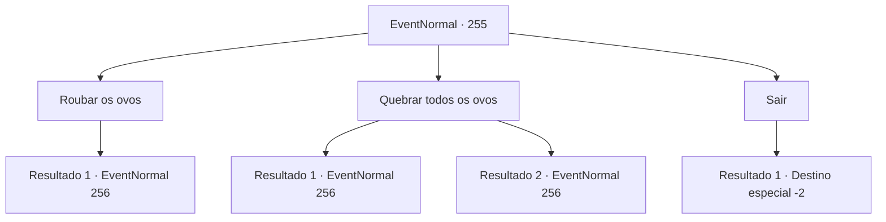

# Eventos normais · 255

[Índice da tabela](index.md) · [Índice geral](../index.md)

ID: `pt:EventNormal:255` · Fonte: `EventNormal4` · Versão: 1.2.47.

Mapeamento estático dos arquivos; a disponibilidade e a execução dependem do estado da run.

## Texto do evento

*Sem texto no arquivo.*

## Dados de entrada

```json
{
  "id": 255,
  "grade": 1,
  "place": "",
  "required": ""
}
```

## Mapa das escolhas



## Escolhas e resultados

### Escolha 1

Roubar os ovos

Requisitos e outros campos da escolha:

```json
{
  "required": ""
}
```

#### Resultado 1.1

Você decide roubar o ovo enorme. Um seria suficiente para fazer uma refeição decente, e dois deles o tirariam de uma crise financeira. Quando você está prestes a descer, segurando cuidadosamente os ovos, você ouve um grito estrondoso de um grifo. Percebendo que a mãe voltou, você puxa sua arma.

Continuação registrada: [Evento 256](0256.md) na mesma tabela.

```json
{
  "required": "",
  "chance": "1",
  "nextEvent": 256,
  "type": 2,
  "reward": "3_200_1|6_0_53",
  "place": 0
}
```

### Escolha 2

Quebrar todos os ovos

Requisitos e outros campos da escolha:

```json
{
  "required": ""
}
```

#### Resultado 2.1

Você começa a quebrar os ovos de grifo um por um. Quando criados por humanos, são ótimos meios de transporte, mas esses são monstros, muito perigosos para serem deixados vivos. Ao terminar de quebrar o segundo ovo, você ouve um grito alto de um grifo. Percebendo que o dono dos ovos voltou, você puxa sua arma.

Continuação registrada: [Evento 256](0256.md) na mesma tabela.

```json
{
  "required": "5_180_2",
  "chance": "1",
  "nextEvent": 256,
  "type": 2,
  "reward": "6_0_53",
  "place": 0
}
```

#### Resultado 2.2

Você começa a quebrar os ovos gigantes um por um. Suas conchas são muito resistentes, então você tem dificuldade em se livrar de uma. Ao terminar de quebrar o segundo ovo, você ouve um grito alto. Quando você olha para trás, um enorme grifo está voando em sua direção. Aparentemente é o dono dos ovos.

Continuação registrada: [Evento 256](0256.md) na mesma tabela.

```json
{
  "required": "18_180_2",
  "chance": "1",
  "nextEvent": 256,
  "type": 2,
  "reward": "6_0_53",
  "place": 0
}
```

### Escolha 3

Sair

Requisitos e outros campos da escolha:

```json
{
  "required": ""
}
```

#### Resultado 3.1

Você decide deixar os ovos de grifo em paz.

Continuação registrada: [Destino especial `-2`](../destinos-especiais.md).

```json
{
  "required": "",
  "chance": "1",
  "nextEvent": -2,
  "type": 2,
  "reward": ""
}
```

## Referências que chegam a este evento

- [Evento 254 · escolha 1 · resultado 1](0254.md#escolha-1)
- [Evento 254 · escolha 1 · resultado 2](0254.md#escolha-1)
- [Evento 254 · escolha 1 · resultado 4](0254.md#escolha-1)
- [Evento 254 · escolha 1 · resultado 5](0254.md#escolha-1)
- [Evento 254 · escolha 3 · resultado 1](0254.md#escolha-3)
- [Evento 254 · escolha 3 · resultado 2](0254.md#escolha-3)
