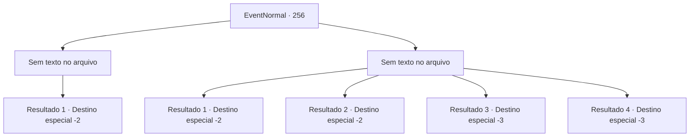

# Eventos normais · 256

[Índice da tabela](index.md) · [Índice geral](../index.md)

ID: `pt:EventNormal:256` · Fonte: `EventNormal4` · Versão: 1.2.47.

Mapeamento estático dos arquivos; a disponibilidade e a execução dependem do estado da run.

## Texto do evento

*Sem texto no arquivo.*

## Dados de entrada

```json
{
  "id": 256,
  "grade": 1,
  "place": "",
  "required": ""
}
```

## Mapa das escolhas



## Escolhas e resultados

### Escolha 1

*Sem texto no arquivo; o papel dessa opção depende da interface do jogo.*

Requisitos e outros campos da escolha:

```json
{
  "required": ""
}
```

#### Resultado 1.1

Em um contra ataque, você derrota o grifo. Em um último bufar, o grifo sucumbe. Você parte, deixando para trás apenas o cadaver gigante do que uma vez foi um grifo.

Continuação registrada: [Destino especial `-2`](../destinos-especiais.md).

```json
{
  "required": "",
  "chance": "1",
  "nextEvent": -2,
  "type": 2,
  "reward": ""
}
```

### Escolha 2

*Sem texto no arquivo; o papel dessa opção depende da interface do jogo.*

Requisitos e outros campos da escolha:

```json
{
  "required": ""
}
```

#### Resultado 2.1

Você dá o seu melhor para derrubar o grifo, mas, machucado, ele foge, deixando para trás apenas seus ovos.

Continuação registrada: [Destino especial `-2`](../destinos-especiais.md).

```json
{
  "required": "1_0_2|1_1_2|8_200_1",
  "chance": "1",
  "nextEvent": -2,
  "type": 2,
  "reward": "0_0_-1|0_1_-1|4_200_1"
}
```

#### Resultado 2.2

Você dá o seu melhor para derrubar o grifo, mas, machucado, ele foge.

Continuação registrada: [Destino especial `-2`](../destinos-especiais.md).

```json
{
  "required": "1_0_2|1_1_2|10_200_1",
  "chance": "1",
  "nextEvent": -2,
  "type": 2,
  "reward": "0_0_-1|0_1_-1"
}
```

#### Resultado 2.3

Você dá o seu melhor para derrubar o grifo, mas é arremessado para o ar pelas garras dele.  Momentos depois, você percebe que está em queda livre, em direção a sua morte.

Continuação registrada: [Destino especial `-3`](../destinos-especiais.md).

```json
{
  "required": "2_0_2",
  "chance": "1",
  "nextEvent": -3,
  "type": 2,
  "reward": "0_0_-1|0_1_-1"
}
```

#### Resultado 2.4

Você dá o seu melhor para derrubar o grifo, mas é arremessado para o ar pelas garras dele.  Momentos depois, você percebe que está em queda livre, em direção a sua morte.

Continuação registrada: [Destino especial `-3`](../destinos-especiais.md).

```json
{
  "required": "2_1_2",
  "chance": "1",
  "nextEvent": -3,
  "type": 2,
  "reward": "0_0_-1|0_1_-1"
}
```

## Referências que chegam a este evento

- [Evento 255 · escolha 1 · resultado 1](0255.md#escolha-1)
- [Evento 255 · escolha 2 · resultado 1](0255.md#escolha-2)
- [Evento 255 · escolha 2 · resultado 2](0255.md#escolha-2)
