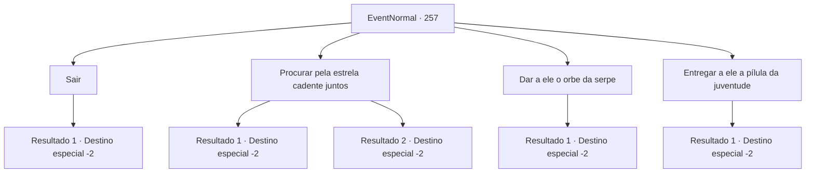

# Eventos normais · 257

[Índice da tabela](index.md) · [Índice geral](../index.md)

ID: `pt:EventNormal:257` · Fonte: `EventNormal4` · Versão: 1.2.47.

Mapeamento estático dos arquivos; a disponibilidade e a execução dependem do estado da run.

## Texto do evento

Você chega a uma pequena cidade enquanto o sol se põe. Você encontra um jovem em uma colina próxima, olhando para o céu. Quando você pergunta a ele por que ele está encarando o céu a esta hora do dia, ele responde. 

 "Na verdade, minha mãe está cronicamente doente. Então, meus dois irmãos: um carpinteiro e um mercador, construíram para ela uma casa confortável para descansar e trouxeram remédios para sua doença."

 Com um suspiro profundo, o jovem continua sua história. 

 "Mas eu não tenho esse talento. Eu estava aqui procurando por uma estrela cadente, para orar à deusa das estrelas para fazer minha mãe ficar saudável."


## Dados de entrada

```json
{
  "id": 257,
  "grade": 1,
  "place": "",
  "required": "5_165_1"
}
```

## Mapa das escolhas



## Escolhas e resultados

### Escolha 1

Sair

Requisitos e outros campos da escolha:

```json
{
  "required": ""
}
```

#### Resultado 1.1

 Você abandona a mulher e parte para outro lugar.

Continuação registrada: [Destino especial `-2`](../destinos-especiais.md).

```json
{
  "required": "",
  "chance": "1",
  "nextEvent": -2,
  "type": 2,
  "reward": "5_165_9"
}
```

### Escolha 2

Procurar pela estrela cadente juntos

Requisitos e outros campos da escolha:

```json
{
  "required": ""
}
```

#### Resultado 2.1

Você conocorda em, junto com o jovem, procurar por estrelas cadentes. Sentado silenciosamente ao lado dele, vocês observam o céu da noite. Algum tempo depois, em um alarde, você aponta para um estrela cadente. Ouvindo seu aviso, o jovem rapidamente fecha os olhos e faz um pedido. A abrir os olhos novamente, o jovem oferece um aperto de mão, expressando sua gratidão. 

 "Obrigado, aventureiro. Graças a você eu fui capaz de encontrar uma estrela cadente."

 Você balança a cabeça, dizendo que não foi nada. Ele sorri e responde. 

 "Da próxima vez que ver uma estrela cadente, garanto que vou orar pelo seu bem estar."

 Ele sorri calorosamente e vai em bora.

Continuação registrada: [Destino especial `-2`](../destinos-especiais.md).

```json
{
  "required": "",
  "chance": "1|0_7_1",
  "nextEvent": -2,
  "type": 0,
  "reward": "0_2_1|5_165_4|0_3_1"
}
```

#### Resultado 2.2

Você conocorda em, junto com o jovem, procurar por estrelas cadentes. Você senta com ele, obervando o céu noturno, ambos a espera de uma estrela cadente. Depois de algum tempo, você sucumbe a fatiga e cai no sono. Na manhã seguinte, assim como você, o jovem acorda, timido e com vergonha. 

 "Acho que o cansaço ganhou dessa vez..."

 Depois de se fitarem desajeitadamente, vocês se separam.

Continuação registrada: [Destino especial `-2`](../destinos-especiais.md).

```json
{
  "required": "",
  "chance": "12",
  "nextEvent": -2,
  "type": 1,
  "reward": "5_165_9|0_3_1"
}
```

### Escolha 3

Dar a ele o orbe da serpe

Requisitos e outros campos da escolha:

```json
{
  "required": "8_45_1"
}
```

#### Resultado 3.1

Você tira o orbe de Wyvern da sua bolsa e deposita nas mãos do jovem. Inicialmente ele não sabia do que se tratava, você explica e ele parece se paralisar.  Estarnecido, ele se recusa a aceitar. 

 "Eu... não posso aceitar algo tão..."

 Você volta a colocar o orbe nas mãos dele, assegurando que está tudo bem. Ele considerou por alguns segundos e se curvou em gratidão, voltando para casa. Enquanto você observa o ceu noturno, uma estrela cadente pode ser vista. Um pequeno sorriso brilha nos seus lábios e você segue seu caminho.

Continuação registrada: [Destino especial `-2`](../destinos-especiais.md).

```json
{
  "required": "",
  "chance": "1",
  "nextEvent": -2,
  "type": 2,
  "reward": "0_2_1|4_45_1|5_165_4|0_3_1"
}
```

### Escolha 4

Entregar a ele a pílula da juventude

Requisitos e outros campos da escolha:

```json
{
  "required": "8_151_1"
}
```

#### Resultado 4.1

Você pega uma Pilula da Juventude da sua bolsa e deposita nas mãos do jovem. Inicialmente ele não sabia do que se tratava, você explica e ele parece se paralisar.  Estarnecido, ele se recusa a aceitar. 

 "Eu... não posso aceitar algo tão..."

 Você volta a colocar o orbe nas mãos dele, assegurando que está tudo bem. Ele considerou por alguns segundos e se curvou em gratidão, voltando para casa. Enquanto você observa o ceu noturno, uma estrela cadente pode ser vista. Um pequeno sorriso brilha nos seus lábios e você segue seu caminho.

Continuação registrada: [Destino especial `-2`](../destinos-especiais.md).

```json
{
  "required": "",
  "chance": "1",
  "nextEvent": -2,
  "type": 2,
  "reward": "0_2_1|4_151_1|5_165_4|0_3_1"
}
```

## Referências que chegam a este evento

Nenhum `nextEvent` positivo da mesma tabela aponta para este nó. Isso não prova que seja inacessível: sorteio e estado de história podem selecioná-lo.

