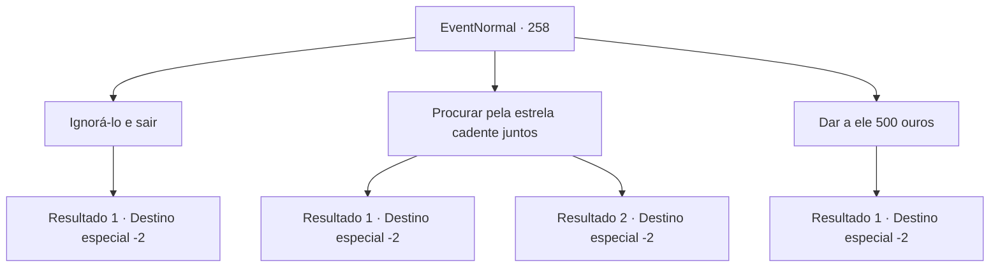

# Eventos normais · 258

[Índice da tabela](index.md) · [Índice geral](../index.md)

ID: `pt:EventNormal:258` · Fonte: `EventNormal4` · Versão: 1.2.47.

Mapeamento estático dos arquivos; a disponibilidade e a execução dependem do estado da run.

## Texto do evento

Você chega a uma cidade no meio da noite e encontra um senhor de meia-idade nas ruas. Na frente dele está um prédio queimado, pronto para desmoronar a qualquer momento. O cavalheiro está apenas sentado lá, olhando fixamente para o céu, sem se importar com a sujeira que cai em suas roupas. Quando você pergunta o que aconteceu, ele responde com os olhos marejados. 

 "Eu costumava ser um mercador viajante. Moeda por moeda, economizei dinheiro suficiente para abrir minha própria loja. Mas... aconteceu um incêndio."

 Ele puxa um lenço do casaco, enxugando as lágrimas, e continua sua história. 

 "A única coisa que posso fazer sem um tostão é orar às estrelas, para me conceder algum dinheiro."


## Dados de entrada

```json
{
  "id": 258,
  "grade": 1,
  "place": "",
  "required": "5_165_2"
}
```

## Mapa das escolhas



## Escolhas e resultados

### Escolha 1

Ignorá-lo e sair

Requisitos e outros campos da escolha:

```json
{
  "required": ""
}
```

#### Resultado 1.1

Você passa pelo cavalheiro que observava as estrelas.

Continuação registrada: [Destino especial `-2`](../destinos-especiais.md).

```json
{
  "required": "",
  "chance": "1",
  "nextEvent": -2,
  "type": 2,
  "reward": "5_165_9"
}
```

### Escolha 2

Procurar pela estrela cadente juntos

Requisitos e outros campos da escolha:

```json
{
  "required": ""
}
```

#### Resultado 2.1

Você concorda em procurar estrelas cadentes, junto com o cavalheiro. Você o dá algumas roupas quentes para o proteger do ar gelado da rua e esperam juntos a estrela cadente aparecer, enquanto o conta histórias de suas aventuras. Após passar algum tempo, você grita para o cavalheiro, apontando na direção da estrela cadente no céu noturno. Ouvindo você exclamar, ele rapidamente fecha os olhos e faz um pedido. Abrindo os olhos de novo, o cavalheiro devolve as roupas quentes que você o deu expressando sua gratidão. 

 "Obrigado. Com sua ajuda eu encontrei a estrela cadente."

 Você balança a cabeça, dizendo que não é nada. Ele continua, sorrindo levemente. 

 "Na próxima vez que eu vir uma estrela cadente, eu vou me garantir de te desejar prosperidade."

 Ele sai andando, deixando para trás uma silhueta solitária.

Continuação registrada: [Destino especial `-2`](../destinos-especiais.md).

```json
{
  "required": "",
  "chance": "1|0_7_1",
  "nextEvent": -2,
  "type": 0,
  "reward": "0_2_1|5_165_5|0_3_1"
}
```

#### Resultado 2.2

Você concorda em procurar estrelas cadentes, junto com o cavalheiro. Você o dá algumas roupas quentes para o proteger do ar gelado da rua e esperam juntos a estrela cadente aparecer, enquanto o conta histórias de suas aventuras. Uma estrela cadente aparece nos cantos do céu noturno, mas você está ocupado de mais contando suas histórias para perceber aquilo. Enfim, na manhã seguinte, o cavalheiro devolve as roupas quentes que você deu, com um olhar triste. 

 "Obrigado por sua história."

 Ele sai andando, deixando para trás uma silhueta solitária.

Continuação registrada: [Destino especial `-2`](../destinos-especiais.md).

```json
{
  "required": "",
  "chance": "12",
  "nextEvent": -2,
  "type": 1,
  "reward": "5_165_9|0_3_1"
}
```

### Escolha 3

Dar a ele 500 ouros

Requisitos e outros campos da escolha:

```json
{
  "required": "1_4_500"
}
```

#### Resultado 3.1

Você dá 500 moedas de ouro ao cavalheiro. O cavalheiro, repentinamente em posse de uma grande quantia de moedas de ouro, te encara espantado. 

 "Você, você está realmente dando isso para mim?"

 Ele hesita por um momento, mas com o seu aceno de cabeça, ele recebe o dinheiro com mãos trêmulas. Ele te abraça e grita, lacrimejando. 

 "Obrigado! Obrigado! Eu vou me reerguer e te pagar por isso algum dia, eu prometo. Obrigado de novo!!"

 Você toca as costas dele, e o dá adeus. Voltando a olhar o céu noturno, uma estrela cadente pode ser vista. Você parte com um pequeno sorriso.

Continuação registrada: [Destino especial `-2`](../destinos-especiais.md).

```json
{
  "required": "",
  "chance": "1",
  "nextEvent": -2,
  "type": 2,
  "reward": "0_2_1|5_165_7|0_3_2|0_4_-500"
}
```

## Referências que chegam a este evento

Nenhum `nextEvent` positivo da mesma tabela aponta para este nó. Isso não prova que seja inacessível: sorteio e estado de história podem selecioná-lo.

