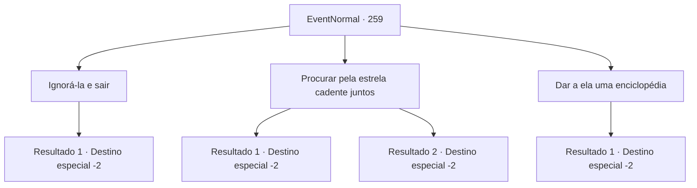

# Eventos normais · 259

[Índice da tabela](index.md) · [Índice geral](../index.md)

ID: `pt:EventNormal:259` · Fonte: `EventNormal4` · Versão: 1.2.47.

Mapeamento estático dos arquivos; a disponibilidade e a execução dependem do estado da run.

## Texto do evento

No início da madrugada, ainda muito cedo para o sol nascer, você encontra uma jovem olhando para o céu enquanto cruza um campo de cultivo. Quando você pergunta por que ela está olhando para o céu a essa hora do dia, ela responde. 

 "Eu quero muito ser professora, mas minha família é pobre, então tenho que trabalhar todos os dias. Então, eu estava esperando as estrelas aparecerem, para fazer um pedido."

 Ela boceja, provavelmente de exaustão, e continua sua história. 

 "Dizem que quando você faz um pedido para uma estrela, ele se torna realidade, certo?"


## Dados de entrada

```json
{
  "id": 259,
  "grade": 1,
  "place": "",
  "required": "5_165_3"
}
```

## Mapa das escolhas



## Escolhas e resultados

### Escolha 1

Ignorá-la e sair

Requisitos e outros campos da escolha:

```json
{
  "required": ""
}
```

#### Resultado 1.1

Você passa pela garota olhando para o céu noturno. Ela mantém o olhar no céu noturno, não dando a mínima para você.

Continuação registrada: [Destino especial `-2`](../destinos-especiais.md).

```json
{
  "required": "",
  "chance": "1",
  "nextEvent": -2,
  "type": 2,
  "reward": "5_165_9"
}
```

### Escolha 2

Procurar pela estrela cadente juntos

Requisitos e outros campos da escolha:

```json
{
  "required": ""
}
```

#### Resultado 2.1

Você concorda em procurar estrelas cadentes com ela, e a cobre com roupas quentes para que ela não adoeça de frio. Após passar algum tempo, você grita para a garota, apontando na direção da estrela cadente no céu noturno. Ouvindo você exclamar, ela rapidamente fecha os olhos e faz um pedido. Abrindo os olhos de novo, a garota grita, abraçando você. 

 "Obrigado, aventureiro. Graças a você eu consegui fazer um pedido a estrela cadente!"

 Você balança a cabeça, dizendo que não é nada. Ela sorri alegremente e continua. 

 "Na próxima vez que eu vir uma estrela cadente, eu vou me garantir de desejar que seus sonhos se realizem."

 Você toca a testa da garota sorridente e vai embora.

Continuação registrada: [Destino especial `-2`](../destinos-especiais.md).

```json
{
  "required": "",
  "chance": "1|0_7_1",
  "nextEvent": -2,
  "type": 0,
  "reward": "0_3_1|0_2_1|5_165_9"
}
```

#### Resultado 2.2

Você concorda em procurar estrelas cadentes com ela, e a cobre com roupas quentes para que ela não adoeça de frio. Após passar algum tempo, você acha estrelas sumindo, e o sol nascendo. Infelizmente, você não foi capaz de encontrar uma estrela cadente antes do amanhecer. A garota fala com uma expressão cheia de desapontamento. 

 "Eu devo ir trabalhar agora, acho que é isso por hoje."

 Você olha para a garota se levantando e voltando para casa, antes de partir.

Continuação registrada: [Destino especial `-2`](../destinos-especiais.md).

```json
{
  "required": "",
  "chance": "12",
  "nextEvent": -2,
  "type": 1,
  "reward": "5_165_9|0_3_1"
}
```

### Escolha 3

Dar a ela uma enciclopédia

Requisitos e outros campos da escolha:

```json
{
  "required": "8_201_1"
}
```

#### Resultado 3.1

Você a entrega uma enciclopédia. A garota olha para o livro espesso com um olhar feliz, antes de voltar seu olhar tremulante para você. 

 "Eu realmente posso ficar com isso?"

 Vendo você acenar, ela abraça apertado a enciclopédia em seus braços e grita de felicidade. Ela está tão feliz, que corre em circulos em torno de você, então te beija na bochecha. 

 "Obrigada, aventureiro! Quando eu virar uma professora, eu vou te ensinar algo que você não sabe!"

 Você se despede dela. Ao olhar para o céu, uma estrela cadente pode ser vista. Você parte com um pequeno sorriso.

Continuação registrada: [Destino especial `-2`](../destinos-especiais.md).

```json
{
  "required": "",
  "chance": "1",
  "nextEvent": -2,
  "type": 2,
  "reward": "4_201_1|0_2_1|5_165_6|0_3_1"
}
```

## Referências que chegam a este evento

Nenhum `nextEvent` positivo da mesma tabela aponta para este nó. Isso não prova que seja inacessível: sorteio e estado de história podem selecioná-lo.

