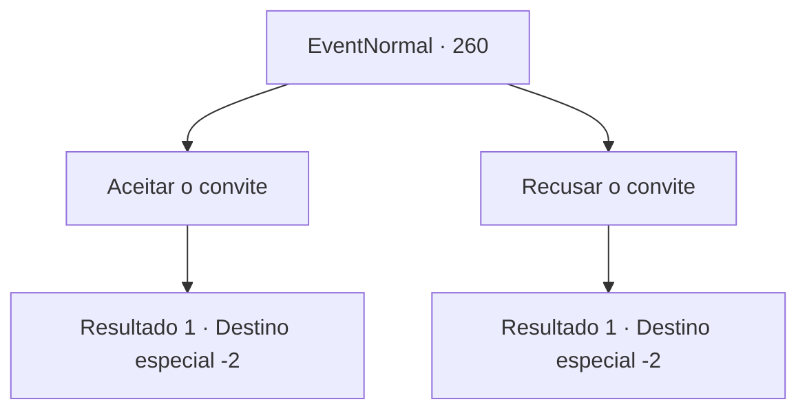

# Eventos normais · 260

[Índice da tabela](index.md) · [Índice geral](../index.md)

ID: `pt:EventNormal:260` · Fonte: `EventNormal4` · Versão: 1.2.47.

Mapeamento estático dos arquivos; a disponibilidade e a execução dependem do estado da run.

## Texto do evento

Você volta para a cidade onde mora o jovem orando por sua mãe doente. A pequena cidade parece diferente de como você se lembra, mas a colina em que você e o jovem se encontraram ainda está lá. Enquanto você lembra dos momentos na colina, surpreendentemente, você ouve a voz do jovem por trás. Felizes com o reencontro, vocês dois começam a falar sobre as coisas mais recentes da vida. 

 "Graças a você, a saúde da minha mãe melhorou muito e agora também tenho um emprego fixo. Se você não se importa, gostaria de convidá-lo para jantar em minha casa."


## Dados de entrada

```json
{
  "id": 260,
  "grade": 1,
  "place": "",
  "required": "5_165_4"
}
```

## Mapa das escolhas



## Escolhas e resultados

### Escolha 1

Aceitar o convite

Requisitos e outros campos da escolha:

```json
{
  "required": ""
}
```

#### Resultado 1.1

Você decide jantar na casa do rapaz. Você é recebido calorosamente pelo rapaz e a família dele. O pão macio e o cozido quente não são nada muito extravagante, mas são mais que suficiente para te deixarem feliz. Assim que você termina de comer e se prepara para ir embora, o rapaz te entrega o que parece ser um talismã. 

 "Isso é um amuleto de boa sorte da minha mãe, feito para você. Eu ia te entregar quando nossos caminhos se cruzassem de novo, e aqui estamos nós. Por favor o aceite."

 Você recusa educadamente, mas não consegue fazê-lo com a mãe do rapaz insista para você aceitar. Você retorna à sua aventura, olhando para as estrelas brilhantes no céu noturno.

Continuação registrada: [Destino especial `-2`](../destinos-especiais.md).

```json
{
  "required": "",
  "chance": "1",
  "nextEvent": -2,
  "type": 2,
  "reward": "0_2_1|3_202_1|5_165_9"
}
```

### Escolha 2

Recusar o convite

Requisitos e outros campos da escolha:

```json
{
  "required": ""
}
```

#### Resultado 2.1

Você educadamente recusa a oferta do rapaz. Ele insiste que você se junte a ele, mas eventualmente aceita respeitar sua decisão. O rapaz te agradece pela última vez, coloca algumas moedas de ouro nos seus bolsos e parte. Você retorna à sua aventura, olhando para as estrelas brilhantes no céu noturno.

Continuação registrada: [Destino especial `-2`](../destinos-especiais.md).

```json
{
  "required": "",
  "chance": "1",
  "nextEvent": -2,
  "type": 2,
  "reward": "0_4_100|5_165_9|0_2_1"
}
```

## Referências que chegam a este evento

Nenhum `nextEvent` positivo da mesma tabela aponta para este nó. Isso não prova que seja inacessível: sorteio e estado de história podem selecioná-lo.

