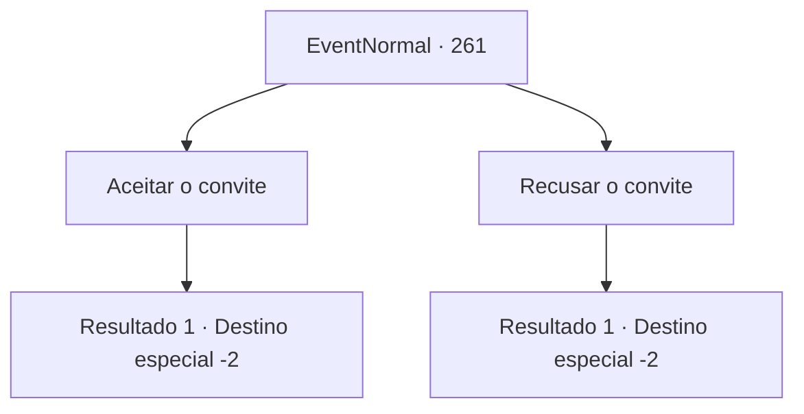

# Eventos normais · 261

[Índice da tabela](index.md) · [Índice geral](../index.md)

ID: `pt:EventNormal:261` · Fonte: `EventNormal4` · Versão: 1.2.47.

Mapeamento estático dos arquivos; a disponibilidade e a execução dependem do estado da run.

## Texto do evento

Você volta para a cidade onde conheceu o senhor de meia-idade, sentado na rua, ao lado do prédio queimado. A cidade parece bem diferente de como você se lembra, e no lugar do prédio queimado há um prédio recém-construído loja do mesmo cavalheiro. Quando ele te vê de dentro da loja, ele grita de surpresa, corre até você e aperta sua mão. Ele fala com você, obviamente gostando do reencontro. Ele está visivelmente mais gordo do que da última vez que você o viu. 

 "Graças a você, pude começar meu próprio negócio novamente. Você não vai visitar minha casa esta noite? Afinal, tenho uma dívida a saldar."


## Dados de entrada

```json
{
  "id": 261,
  "grade": 1,
  "place": "",
  "required": "5_165_5"
}
```

## Mapa das escolhas



## Escolhas e resultados

### Escolha 1

Aceitar o convite

Requisitos e outros campos da escolha:

```json
{
  "required": ""
}
```

#### Resultado 1.1

Você decide visitar a casa do cavalheiro de meia idade. Você é recebido luxuosamente pelo cavalheiro e seus servos. Quando que você está terminando a feliz refeição, ele te entrega uma espada. 

 "Eu lhe preparei isso, como presente para você quando nos vissemos de novo. Por favor, aceite isso como símbolo da minha gratidão."

 Você aceita a rapieira prateada e retorna à sua aventura.

Continuação registrada: [Destino especial `-2`](../destinos-especiais.md).

```json
{
  "required": "",
  "chance": "1",
  "nextEvent": -2,
  "type": 2,
  "reward": "0_2_1|3_102_1|5_165_9"
}
```

### Escolha 2

Recusar o convite

Requisitos e outros campos da escolha:

```json
{
  "required": ""
}
```

#### Resultado 2.1

Você educadamente recusa a oferta do cavalheiro. Você retorna à sua aventura, olhando para as estrelas brilhantes no céu noturno.

Continuação registrada: [Destino especial `-2`](../destinos-especiais.md).

```json
{
  "required": "",
  "chance": "1",
  "nextEvent": -2,
  "type": 2,
  "reward": "0_2_1|0_3_1|5_165_9"
}
```

## Referências que chegam a este evento

Nenhum `nextEvent` positivo da mesma tabela aponta para este nó. Isso não prova que seja inacessível: sorteio e estado de história podem selecioná-lo.

