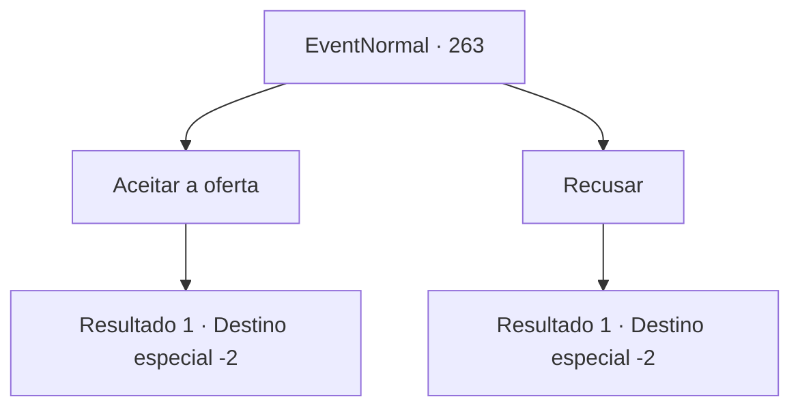

# Eventos normais · 263

[Índice da tabela](index.md) · [Índice geral](../index.md)

ID: `pt:EventNormal:263` · Fonte: `EventNormal4` · Versão: 1.2.47.

Mapeamento estático dos arquivos; a disponibilidade e a execução dependem do estado da run.

## Texto do evento

Em uma cidade sem nome, você encontra a garota que pedia desejos às estrelas. Ela ainda está segurando a enciclopédia que você deu a ela e ficou muito mais alta. Quando ela te vê, sai correndo em sua direção, acenando com as mãos, compartilhando a felicidade do reencontro. 

 "Graças a você, eu vou para a escola hoje em dia! Ah! Você se importaria de observar as estrelas esta noite novamente, em busca de estrelas cadentes?"


## Dados de entrada

```json
{
  "id": 263,
  "grade": 1,
  "place": "",
  "required": "5_165_6"
}
```

## Mapa das escolhas



## Escolhas e resultados

### Escolha 1

Aceitar a oferta

Requisitos e outros campos da escolha:

```json
{
  "required": ""
}
```

#### Resultado 1.1

Você decide assistir as estrelas cadentes com a garota. Assim como da última vez, vocês dois conversam sob o céu noturno, Você sente o frio no ar. Você se prepara para a acompanhar até o quarto dela. Mas então, algo toca dua mão. Ao checar sua mão, surpreso, há um talismã inscrito com um sigilo. A garota fala, sorrindo alegremente. 

 "Eu lhe fiz isso, como presente para você quando nos vissemos de novo! Por favor o aceite!"

 Você recusa educadamente, mas acaba aceitando com a insistência da garota para que você o pegue. Ao olhar de volta para o céu noturno, uma estrela cadente pode ser vista.

Continuação registrada: [Destino especial `-2`](../destinos-especiais.md).

```json
{
  "required": "",
  "chance": "1",
  "nextEvent": -2,
  "type": 2,
  "reward": "0_2_1|3_202_1|5_165_9"
}
```

### Escolha 2

Recusar

Requisitos e outros campos da escolha:

```json
{
  "required": ""
}
```

#### Resultado 2.1

Você educadamente recusa a oferta dela. Com um olhar desapontado no rosto, ela fala. 

 "Sei... Eu entendo, você deve estar ocupado. Eu não vou te incomodar então, Obrigado por sua ajuda de qualquer forma."

 Então ela acena para você com adeus.

Continuação registrada: [Destino especial `-2`](../destinos-especiais.md).

```json
{
  "required": "",
  "chance": "1",
  "nextEvent": -2,
  "type": 2,
  "reward": "0_2_1|5_165_9|0_3_1"
}
```

## Referências que chegam a este evento

Nenhum `nextEvent` positivo da mesma tabela aponta para este nó. Isso não prova que seja inacessível: sorteio e estado de história podem selecioná-lo.

