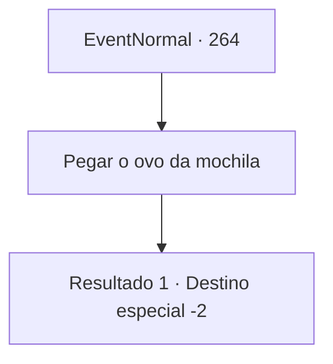

# Eventos normais · 264

[Índice da tabela](index.md) · [Índice geral](../index.md)

ID: `pt:EventNormal:264` · Fonte: `EventNormal4` · Versão: 1.2.47.

Mapeamento estático dos arquivos; a disponibilidade e a execução dependem do estado da run.

## Texto do evento


*cr... crack..crack..*
 Você ouve algo que parece madeira estalando. Está vindo de dentro da sua mochila. Quando você abre sua bolsa, o ovo gigante de ouro está chocando.

## Dados de entrada

```json
{
  "id": 264,
  "grade": 3,
  "place": "",
  "required": "8_200_1|18_180_0"
}
```

## Mapa das escolhas



## Escolhas e resultados

### Escolha 1

Pegar o ovo da mochila

Requisitos e outros campos da escolha:

```json
{
  "required": ""
}
```

#### Resultado 1.1

Você pega o ovo na bolsa. Logo, um bebê grifo choca do ovo. Ele encara você com olhos arredondados. Então ele se esfrega em você. Aparentemente ele o considera sua mãe.

Continuação registrada: [Destino especial `-2`](../destinos-especiais.md).

```json
{
  "required": "",
  "chance": "1",
  "nextEvent": -2,
  "type": 2,
  "reward": "4_200_1|3_203_1|5_180_3"
}
```

## Referências que chegam a este evento

Nenhum `nextEvent` positivo da mesma tabela aponta para este nó. Isso não prova que seja inacessível: sorteio e estado de história podem selecioná-lo.

