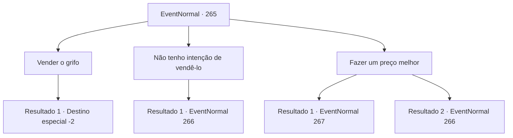

# Eventos normais · 265

[Índice da tabela](index.md) · [Índice geral](../index.md)

ID: `pt:EventNormal:265` · Fonte: `EventNormal4` · Versão: 1.2.47.

Mapeamento estático dos arquivos; a disponibilidade e a execução dependem do estado da run.

## Texto do evento

Enquanto você está sentindo o bebê grifo dentro da sua bolsa, uma carroça luxuosamente decorada passa por você. Logo a carroça para e um homem vestido de seda sai dela. Ele se aproxima de você com uma cara cheia de curiosidade. 

 "Isso... deve ser um bebê grifo! Onde você... você se importaria de vender para mim? Eu pago 200 ouros."


## Dados de entrada

```json
{
  "id": 265,
  "grade": 2,
  "place": "",
  "required": "8_203_1|5_180_3"
}
```

## Mapa das escolhas



## Escolhas e resultados

### Escolha 1

Vender o grifo

Requisitos e outros campos da escolha:

```json
{
  "required": ""
}
```

#### Resultado 1.1

Você alegremente o entrega o bebê grifo por 200 moedas de ouro. O bebê grifo vira a cabeça de um lado para o outro, como se não entendesse o que está acontecendo. 

 "Muitíssimo obrigado! Não se preocupe sobre cuidar dele. Eu o criarei com todo meu coração."

 Ele põe um sorriso satisfeito, olhando para o bebê grifo em seus braços. Ele então retorna ao vagão e parte.

Continuação registrada: [Destino especial `-2`](../destinos-especiais.md).

```json
{
  "required": "",
  "chance": "1",
  "nextEvent": -2,
  "type": 2,
  "reward": "4_203_1|0_4_200|5_180_4"
}
```

### Escolha 2

Não tenho intenção de vendê-lo

Requisitos e outros campos da escolha:

```json
{
  "required": ""
}
```

#### Resultado 2.1

Você recusa a oferta do homem com vestes de seda. Ele cruzou os braços e rumina 'Hmm...'. Ele abre a boca de novo. 

 "Então... que tal isso? Se você derrotar meu guarda costas numa luta, então eu desistirei do grifo. E claro que essa é uma oferta que você não pode recusar."

 Ao gesticular com a mão, o guia do vagão desce de seu assento. Então ele saca sua espada.

Continuação registrada: [Evento 266](0266.md) na mesma tabela.

```json
{
  "required": "",
  "chance": "1",
  "nextEvent": 266,
  "type": 2,
  "reward": ""
}
```

### Escolha 3

Fazer um preço melhor

Requisitos e outros campos da escolha:

```json
{
  "required": ""
}
```

#### Resultado 3.1

Você diz ao homem com vestes de seda que 200 moedas de ouro não servirão. Você também acrescenta que a não ser que ele aumente o preço, ele não pode ter o grifo. Ele rumina 'Hmm...' por um segundo e após uma breve consideração, fala de novo. 

 "Está certo... bom. Você deve ter se esforçado o criando até agora. 250 moedas. Que tal?"


Continuação registrada: [Evento 267](0267.md) na mesma tabela.

```json
{
  "required": "",
  "chance": "1|0_12_1",
  "nextEvent": 267,
  "type": 0,
  "reward": ""
}
```

#### Resultado 3.2

Você diz ao homem com vestes de seda que 200 moedas de ouro não servirão. Você também acrescenta que a não ser que ele aumente o preço, ele não pode ter o grifo. Ele rumina 'Hmm...' por um segundo e após uma breve consideração, fala de novo. 

 "Então... que tal isso? Se você derrotar meu guarda costas numa luta, então eu desistirei do grifo. E claro que essa é uma oferta que você não pode recusar."

 Ao gesticular com a mão, o guia do vagão desce de seu assento. Então ele saca sua espada.

Continuação registrada: [Evento 266](0266.md) na mesma tabela.

```json
{
  "required": "",
  "chance": "12",
  "nextEvent": 266,
  "type": 1,
  "reward": ""
}
```

## Referências que chegam a este evento

Nenhum `nextEvent` positivo da mesma tabela aponta para este nó. Isso não prova que seja inacessível: sorteio e estado de história podem selecioná-lo.

